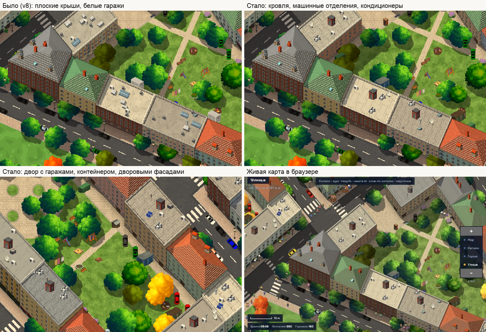

# Детальный пиксель

Браузерная пиксель-арт карта мира с живыми жителями. Открыть: `index.html` (всё в одном файле, без сервера).

- **Движок** (`src/`): процедурный мир, схемы городов (Москва, Париж, Нью-Йорк, Стамбул), улицы, кварталы, двери и мебель — единый «скелет», по которому ходят люди и ездят машины.
- **Набор деталей** (`data/kit.png`, `data/kit.json`): фасады, кровля, деревья, мелкие объекты и машины, сгенерированные открытыми моделями (Z-Image-Turbo, Qwen-Image-2.1) и собранные инструментами из `tools/ai/`.
- Сборка: `node build.js` → `index.html`.

Данные OpenStreetMap не используются. Часть спрайтов сделана Qwen-Image-2.1 (Qwen Research License) — проект экспериментальный, некоммерческий.

