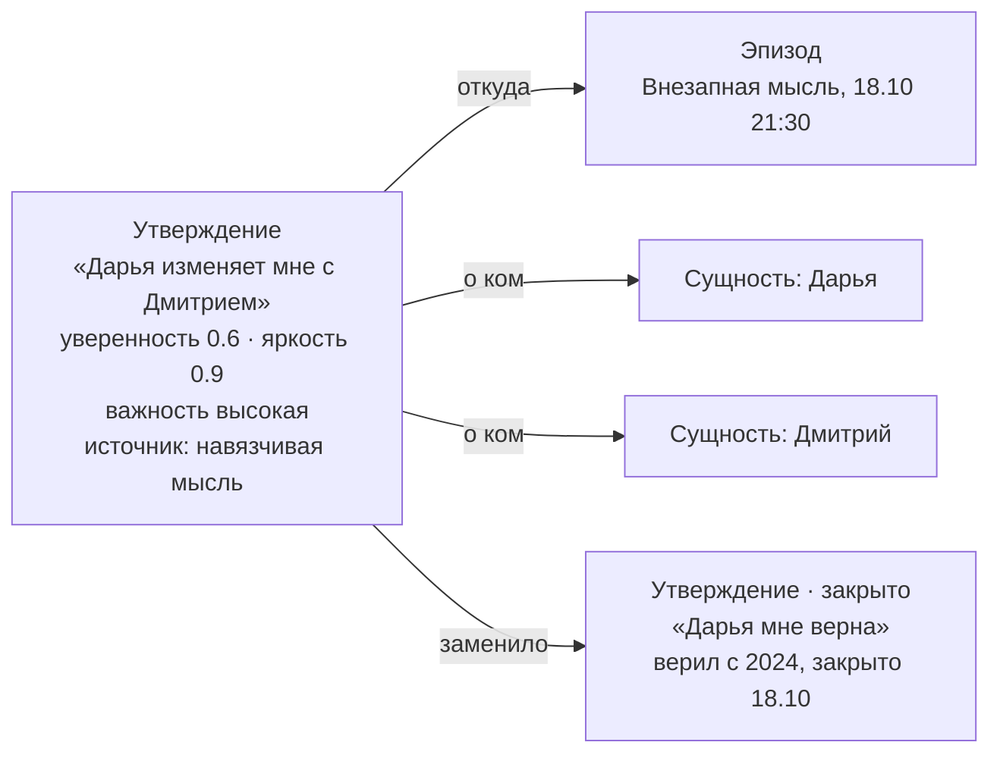
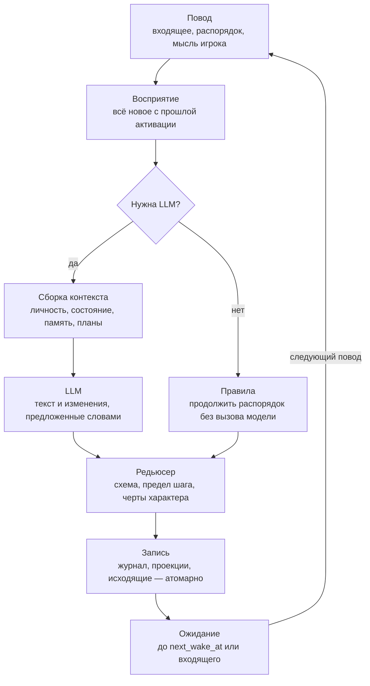

# Ядро персонажа — модель v1

Обновлено: 18.10.2026

## Статус и рамки

Здесь зафиксирована модель ядра персонажа v1: личность, память, отношения и когда что сохраняется. Это рабочая договорённость, любую часть можно пересмотреть.

Ядро — это модель данных персонажа, его память, отношения и цикл активации. Движки отношений и поведения — внешние клиенты ядра. Событийный движок и часть разделов телефона отложены — см. «Отложено в v2» в конце.

| Тема | Решение |
| --- | --- |
| Масштаб | Тысячи персонажей, все «живые»: планировщик будит каждого по своему алгоритму |
| Время | 1:1 с реальным, у каждого персонажа свой часовой пояс |
| LLM | Облачный API, бюджет позволяет много вызовов |
| Реализация | Отдельный репозиторий, сервис на Python; технические детали позже |
| Мир | Общий для всех игроков |
| Что видит игрок | Только телефон персонажа |
| Вмешательство | Игрок берёт персонажа и блокирует его на время. Влияет только сообщениями от его имени и подсаженными мыслями, прямых правок данных нет |

## Принципы

Семь правил, которые держат персонажа согласованным на месяцах жизни и тысячах вызовов модели.

1. **Журнал — источник правды.** Всё пережитое и все изменения пишутся в журнал персонажа только дописыванием. Остальные слои — проекции, их можно пересобрать.
2. **Модель предлагает, код применяет.** LLM пишет текст и предлагает изменения словами. Код проверяет схему, ограничивает шаг, учитывает характер и применяет.
3. **Факт, убеждение и текст — разные вещи.** Мир знает, что было. Персонаж знает, во что верит и откуда узнал. Сообщение — это утверждение, и система знает, верит ли в него автор, то есть видит ложь.
4. **Показанное — канон.** Отправленное сообщение и открытый игроком экран телефона не перегенерируются. Второй игрок увидит то же самое.
5. **Скорость изменения определяет хранение и место в промпте.** Статичное идёт в начало промпта и кешируется. Быстрое идёт в конец и считается при чтении.
6. **Личность недоступна конвейеру памяти.** Её меняет только генерация мира. Дрейф черт — отдельная поправка с потолком, она меняется только во сне.
7. **Вмешательство идёт тем же путём, что и жизнь.** Сообщение игрока и подсаженная мысль — обычные эпизоды. Их эффект проходит через тот же разбор и те же ограничения.

## Слои персонажа

Персонаж состоит из 10 слоёв, разложенных по скорости изменения. Чем медленнее слой, тем меньше путей его изменить.

| # | Слой | Что внутри | Как меняется | Кто меняет |
| --- | --- | --- | --- | --- |
| 1 | Личность | Имя, пол, возраст, внешность, часовой пояс. Big Five и игровые черты: импульсивность, ревнивость, честность, амбиции, внушаемость, злопамятность. Ценности, страхи, слабости. Интересы: веса тем (политика, спорт, транспорт…) и привычка следить за новостями | Не меняется. Дрейф черт — поправка с потолком, только во сне | Генерация мира |
| 2 | Голос | Язык, длина сообщений, грамотность, эмодзи, мат, сленг, скорость ответа, сова или жаворонок | Не меняется | Генерация мира |
| 3 | Биография | Ключевые факты прошлого как ссылки на общие мировые факты. Связный рассказ генерируется из них | Только дописывается | Генерация мира; сон добавляет «главы жизни» |
| 4 | Положение в мире | Профессия, работа, деньги, жильё. Жив, мёртв, пропал или в тюрьме. Власть (полномочия) и охват (аудитория) | Медленно, по итогам действий | Итоги действий по правилам |
| 5 | Отношения | Направленные связи A→B: роли, шесть шкал, причины с затуханием | После взаимодействий | Редьюсер по предложениям LLM |
| 6 | Знания и мнения | Граф памяти: сущности, эпизоды, утверждения | После эпизодов и во сне | Конвейер памяти |
| 7 | Цели и планы | Жизненные цели, проекты, обязательства (календарь), план дня, незакрытые сюжетные нити | От дней до минут | Сам персонаж |
| 8 | Текущее состояние | Место, занятие, общее настроение, потребности (усталость, стресс, одиночество, деньги), доступность, блокировка игроком, временные модификаторы (пьян, в шоке) | Постоянно; затухание считается при чтении | Распорядок и активации |
| 9 | Журнал опыта | Эпизоды и все изменения состояния | Только дописывается | Цикл активации |
| 10 | Производная память | Сводки дня, недели и «глав жизни», сводки по людям и темам, эмбеддинги | Пересобирается | Сон |

«Серые» и «медийные» — одна модель с разными властью и охватом. Петя, поднявший революцию, — это рост охвата. Слой голоса самый важный для телефона: игрок видит только тексты.

## Входные потоки и эпизоды

Всё, что узнаёт персонаж, становится эпизодом: «со мной что-то произошло, источник такой-то». Память строится из эпизодов одинаково, откуда бы они ни пришли.

| Источник | Пример эпизода |
| --- | --- |
| Переписка или звонок | «Вечерняя переписка с Дарьей, 18.10, 21:40–22:15» |
| Личное присутствие | «Был на дне рождения у Лены» |
| Свои действия | «Купил цветы, поехал к Дарье» |
| Мысль, в том числе подсаженная | «Вдруг подумал, что Дарья что-то скрывает» |

Эпизод — это сцена, а не одно сообщение. Переписка закрывается после 30 минут тишины, после 16 сообщений или когда сумма важности ходов дошла до 2.0 и наступила пауза в 5 минут. Это стартовые значения для калибровки. Лимит нужен, чтобы старые реплики не выпали из контекста до закрытия.

Эпизод хранит время, место, участников и ссылки на сырьё: сообщения и записи лога. Сырьё общее для всех участников, а выводы у каждого свои: Дарья вынесет из той же ссоры другое, чем Алексей.

## Граф памяти

Память — граф из трёх видов узлов. Типизирована форма, а не смысл: «о себе», «о других», «о мире» — это то, о ком утверждение, а не отдельные типы. Новые типы под сценарии не нужны.

| Узел | Что это | Пример |
| --- | --- | --- |
| Сущность | Человек, место, организация, предмет, тема, событие мира | Дарья, Москва, «война США–Иран» |
| Эпизод | Что со мной произошло: когда, где, с кем, ссылки на сырьё | Переписка с Дарьей 18.10 |
| Утверждение | Что я считаю правдой, со ссылками «о ком» и «откуда» | «Дарья изменяет мне с Дмитрием» |

Связи: «о ком» (утверждение → сущность), «участник» (эпизод → сущность), «откуда» (утверждение → эпизод), «заменило» и «противоречит» (утверждение → утверждение).



Подсаженная мысль стала эпизодом, из него выведено утверждение о Дарье и Дмитрии. Прежнее «Дарья мне верна» закрыто датой, а не удалено.

### Поля утверждения

| Поле | Смысл | Как меняется |
| --- | --- | --- |
| Текст | Так, как сформулировал бы сам персонаж | — |
| О ком | Ссылки на сущности, обязательны. Без них не найти противоречия | — |
| Уверенность | Насколько верит: 0.3 слух или свой вывод, 0.6 намёк, 0.85 сказано прямо, 1.0 подтверждено действием | Только доказательствами; умножается на доверие к источнику |
| Яркость | Насколько легко вспоминается | Затухает со временем, растёт при использовании в ответе |
| Важность | Эмоциональный вес | Замедляет затухание яркости: измену не забывают, сорт кофе забывают |
| Источник | Видел сам, сказал X, новости, сам вывел, навязчивая мысль | — |
| Время | Когда узнал; когда это верно в мире (с — по) | Старое закрывается датой, не удаляется |
| Видимость | Секрет или нет, кому уже рассказал | При каждом рассказе |
| Связь с мировым фактом | Только для системы: прав ли он, лжёт ли. Персонаж её не видит | — |

### Правила

- «X говорит, что P» и «я считаю, что P» — разные утверждения. На этом держатся слухи и ложь.
- Уверенность растёт только от разных источников. Пять пересказов Дмитрия — один источник.
- Если среди источников слитого утверждения есть пересказ, итог остаётся пересказом и не становится «видел сам».
- В отбор в промпт входят релевантность, яркость и важность. Уверенность задаёт тон: уверенно или «вроде бы».
- Забывание снижает яркость, но не стирает запись. Телефон помнит всё, поэтому игрок может знать о персонаже больше, чем тот помнит сам.

### Общее и личное

- События мира и персонажи — общие узлы, по одному на мир. У каждого персонажа только свои утверждения о них.
- Личные сущности («мой кот Мурка», «тот парень из бара») при необходимости становятся общими.
- Имена привязываются к сущностям через контакты телефона: «Даша❤️» — это Дарья.
- Отношение к знаменитостям и политикам — мнения в графе, а не связи отношений.
- Граф — это модель данных. Хватает таблиц узлов и связей плюс векторного поиска, графовая база данных не нужна.

## Конвейер памяти

Память обновляется в три момента, и модель не вызывается на каждую реплику. Кратковременная память — это последние сообщения в контексте.

1. **Во время диалога.** Ответ плюс только срочное: эмоции, обязательства, важность хода. «Встретимся в 19:00» сразу идёт в календарь, иначе он не придёт. Извлечения утверждений нет.
2. **Закрытие эпизода.** Один вызов на каждого участника. Он даёт сводку от лица участника, изменения отношений и 0–5 кандидатов в утверждения.
   - Кандидат: о ком, что, кто сказал, уверенность, какие утверждения подтверждает и каким противоречит.
   - Кандидаты сразу доступны и помечены «свежее». Персонаж помнит, что было час назад, хотя сжатие идёт ночью.
3. **Сон** (ночь по часовому поясу персонажа). Кандидаты сливаются в устоявшиеся утверждения или отбрасываются. Старые версии закрываются датой, дубликаты по смыслу склеиваются.
   - Яркость затухает, делаются выводы («Дарья последнее время холодна»).
   - Постоянные части причин в отношениях ложатся в базу, составляется план на завтра.
   - Ночная обработка ложится на batch-запросы к API.

Раз в неделю или месяц сводки сжимаются в «главы жизни».

### Фильтры извлечения

- Вопрос «будет ли это правдой через неделю?» отсекает ситуативное.
- Порог важности: мелочи («Дарья пила латте») остаются только в эпизоде и в телефоне.
- Пустой ответ — нормальный результат, а не сбой.
- В обмене с моделью — короткие номера вместо id, ссылки на источники обязательны.

## Оптимизация памяти

Память держится в бюджете тремя приёмами: сжимать (сводки), забывать (яркость гаснет, запись остаётся) и отбирать (в промпт попадает только нужное). Почти всё делает код; модель вызывается при закрытии эпизода и во сне. Все числа ниже — стартовые значения, их калибруем прогоном недели жизни на подменяемых часах.

| Механизм | Что делает | Когда | Кто |
| --- | --- | --- | --- |
| Окно переписки | В промпт идут последние сообщения чата сырыми (до 1 500 токенов или 30 штук), прошлые эпизоды с этим человеком — сводками | Каждый ответ | Код |
| Сводка эпизода | 1–3 предложения от лица персонажа вместо сырой переписки | Закрытие эпизода | LLM, в том же вызове, что извлечение |
| Фильтр извлечения | 0–5 кандидатов: только то, что верно через неделю, с важностью не ниже 0.2 | Закрытие эпизода | LLM + код (лимит, порог) |
| Консолидация | Кандидат сливается с похожим утверждением, заменяет его, становится новым или отбрасывается. Кандидат живёт только до ближайшего сна | Сон | LLM решает, код применяет |
| Склейка дубликатов | Одинаковые по смыслу утверждения сливаются в одно | Сон, только по сущностям, затронутым за день | Эмбеддинги находят, LLM подтверждает |
| Затухание яркости | Яркость падает по экспоненте с полураспадом от важности | При чтении | Код |
| Укрепление | Использованное в ответе воспоминание снова яркое и дальше гаснет медленнее | После каждого ответа | Код, по списку использованных номеров из ответа |
| Спящая память | Утверждения и эпизоды с яркостью ниже 0.05 не участвуют в обычном отборе | При чтении; индекс перестраивается во сне | Код |
| Дайджест человека | «Что я знаю о Даше» — 5–10 строк вместо десятков утверждений | Сон, только по людям с новыми утверждениями | LLM, дешёвая модель |
| Выводы | 1–3 обобщения дня как новые утверждения с источником «сам вывел» («Даша отдаляется») | Сон, если сумма важности эпизодов дня ≥ 2.0 | LLM |
| Сводки дня, недели, главы | Дневник дня → сводка недели → «глава жизни». Детали гаснут, суть остаётся | День — каждый сон; неделя — в ночь на понедельник; глава — раз в месяц или после крупного события (расстались, сменил работу) | LLM, batch |
| Причины в отношениях | Постоянные части причин дня ложатся в базу (не больше 0.1 в сутки), погасшие временные удаляются; на связь хранится до 10 самых значимых шрамов для объяснений | Сон | Код |
| Лимит активной памяти | Сверх \~1 500 активных утверждений на персонажа самые слабые уходят в спящие | Сон | Код |
| Кеш промпта | Личность и голос — неизменный префикс для всех вызовов персонажа; примеры голоса обновляются раз в неделю, чтобы не сбивать кеш | Каждый вызов | Провайдер API |

### Яркость и забывание

Яркость считается при чтении по времени последнего использования; важное и часто вспоминаемое гаснет медленнее.

```latex
s(t) = s_0 \cdot 2^{-\Delta t / h}, \qquad h = h_0 \, (1 + 30 I^2) \cdot 1.5^{\,n}
```

s0 — яркость после последнего использования (1.0), Δt — время с него, I — важность 0…1, n — сколько раз воспоминание использовалось, h0 = 2 дня. Полураспад h не больше года.

| Важность | Пример | Полураспад | До спящей памяти без вспоминания |
| --- | --- | --- | --- |
| 0.2 | «Даша любит латте» | \~4 дня | \~19 дней |
| 0.5 | «поссорился с коллегой» | \~17 дней | \~2,5 месяца |
| 1.0 | «Даша мне изменила» | \~2 месяца | \~9 месяцев |

- **Спящая запись не удаляется.** Она остаётся в графе, в журнале и в телефоне.
- **Спящая запись возвращается по сильной подсказке:** прямое упоминание её сущности и релевантность не ниже 0.8. Тогда персонаж «вспомнил», яркость становится 0.5.
- **Суть переживает детали.** Уснувшие эпизоды уже вошли в сводки недели и главы, и сводки продолжают попадать в отбор.

### Отбор в промпт

У каждого кандидата на место в контексте считается один балл, дальше работают квоты и порог.

```latex
\text{score} = 0.5\,\text{rel} + 0.3\,s + 0.2\,I + 0.2\,[\text{о собеседнике или упомянутом}]
```

- rel — косинус к запросу. Запрос = последние 3 сообщения + свежие кандидаты за последние часы, чтобы то, что «на уме», влияло на отбор.
- Квоты по «о ком»: собеседник 5, упомянутые 4, я 2, мир 1. Общий бюджет блока \~800 токенов.
- Балл ниже 0.35 не берётся даже при свободной квоте. Спящие записи в отборе не участвуют.
- Уверенность в балл не входит — она задаёт слова: ≥ 0.95 «знаешь точно», 0.8–0.95 «уверен», 0.5–0.8 «похоже на то», ниже 0.5 «слышал» или «подозреваешь».

### Консолидация во сне

1. Для каждого кандидата код находит похожие утверждения: общие сущности и косинус не ниже 0.8.
2. Модель получает кандидатов и похожие утверждения под короткими номерами и для каждого кандидата выбирает: слить, заменить, новое или отбросить. Каждое решение ссылается на номера.
3. Код применяет: слияние объединяет источники, замена закрывает старое датой, отброшенный кандидат остаётся только в эпизоде.
4. Уверенность после слияния считается по независимым источникам (формула ниже).
5. Замена происходит, если у нового утверждения уверенность выше старого хотя бы на 0.2 или это личное свидетельство. Иначе оба остаются с пометкой «противоречит», и в промпт идёт «считал X, но недавно услышал Y».

```latex
c = 1 - \prod_i \left(1 - c_i \, t_i\right)
```

ci — уверенность по источнику i, ti — доверие к нему (для «видел сам» и «сам вывел» — 1). Источник — это первоисточник: пересказ Лены через Диму считается одним источником — Леной. Без личного свидетельства уверенность не выше 0.95.

Итого за сутки на персонажа во сне: один вызов консолидации и сводки дня, плюс дайджесты по людям, о которых узнал новое. Всё идёт через batch.

## Профиль интересов

Профиль интересов решает, о чём персонаж заговаривает сам и что охотно пересказывает. В v2 он же отбирает, какие новости до него доходят. Это часть слоя «Личность»: задаётся при генерации мира и меняется медленно.

| Поле | Что это | Пример: Алексей |
| --- | --- | --- |
| Веса тем | 0…1 по общему списку тем: политика, экономика и деньги, транспорт, спорт, культура, технологии, здоровье, криминал, религия, семья и отношения | Транспорт 0.8, спорт 0.6, деньги 0.5, политика 0.1 |
| Привычка следить за новостями | 0…1: насколько часто узнаёт новости из общего канала новостей, а не от знакомых | 0.7 |
| Стартовые позиции | Для тем с весом от 0.5 — начальные мнения, записанные утверждениями в граф памяти | «Платные парковки в центре — грабёж» |

### Как меняется

- Создаётся моделью вместе с личностью и согласуется с профессией, возрастом и биографией.
- Во сне веса сдвигаются не больше чем на 0.05 за ночь к темам эпизодов дня. Темы эпизода код определяет по эмбеддингу сводки, без вызова модели.
- Без подкрепления веса медленно возвращаются к стартовым. Если Алексей неделями обсуждает с Димой футбол, интерес к спорту растёт.
- Прямых правок нет: игрок влияет на интересы только через разговоры и подсаженные мысли.

### Где используется

| Механизм | Что берёт из профиля |
| --- | --- |
| Отбор новостей (v2) | Вес темы и привычку следить за новостями — множители в балле новости (см. «Отложено в v2») |
| Движок отношений | О чём персонаж заговаривает первым |
| Слухи | Истории и слухи на свои темы пересказывает охотнее |

## Отношения

Связь A→B направленная и состоит из трёх частей: роли, шесть устойчивых шкал и причины с затуханием. Базовые эмоции — это свежие причины с ярлыком, а не отдельные шкалы.

### Роли

Мать, партнёр, бывший, коллега, начальник, одноклассник, сосед; как и когда познакомились. Это общие мировые факты, обе стороны их знают. Переходы «расстались» или «поженились» — события-решения, а не пересечение порога.

### Шкалы

Шкала существует, только если её читает какая-то механика.

| Шкала | Диапазон | Что от неё зависит |
| --- | --- | --- |
| Тепло (ненависть … любовь) | −1…+1 | Хочется ли общаться, тон, готовность помочь |
| Доверие | 0…1 | Верит ли словам (множитель уверенности в памяти), рассказывает ли секреты |
| Уважение (презрение … восхищение) | −1…+1 | Насколько B влияет на мнения A, слушается ли A |
| Страх | 0…1 | Подчинение, избегание, ложь «чтобы не узнал», не спорит |
| Влечение | 0…1 | Романтическая инициатива, ревность. Отдельно от тепла |
| Близость (насколько знаю) | 0…1 | Что о нём знаю, что ему рассказываю, привычная частота контактов. Растёт и падает медленно |

Сочетания дают сюжет сами: тепло без доверия — ревность и драма, уважение со страхом — зависимость, тепло без близости — фанат. «Отвращение» — это низкое тепло плюс низкое уважение, отдельная шкала не нужна.

### Причины и эмоции

Каждое изменение шкалы — причина из двух частей. **Временная** часть гаснет со временем — это эмоция. **Постоянная** часть во сне навсегда ложится в базу шкалы — это осадок. Модель словами выбирает только срок, доли частей считает код.

```latex
v(t) = B + \sum_i T_i \cdot 2^{-\Delta t_i / h_i}
```

B — база шкалы, Ti — временная часть причины i, hi — её полураспад. Постоянные части Pi во сне прибавляются к B и дальше не гаснут. Текущее значение считается при чтении.

| Срок | Полураспад временной части | Доля постоянной части | Пример |
| --- | --- | --- | --- |
| Момент | Часы | 0 | Вспылил из-за опоздания |
| Дни | \~3 дня | 5% | Неудачная шутка, мелкая ссора |
| Недели | \~3 недели | 15% | Обвинение, серьёзная ссора |
| Надолго | \~2 месяца | 50% | Доказанная измена, предательство, насилие |

Постоянная часть = сдвиг × доля по сроку × уверенность в основании × множитель характера и шкалы. Остальное — временная часть.

- **Уверенность в основании.** Если причина держится на убеждении, постоянная часть умножается на его уверенность в момент сна. Подозрение (0.6) оставляет маленький шрам, доказанная измена (1.0) — большой. Для пережитого действия («накричал», «соврал при мне») множитель 1.
- **Постоянная часть применяется во сне, а не сразу.** Если до сна основание опровергнуто (Даша доказала, что была у Лены), она не применяется. Временная гаснет как обычно: злость не проходит мгновенно.
- **Характер.** Злопамятность увеличивает долю постоянной части у негативных причин, отходчивость уменьшает. Ревнивость усиливает сдвиги по доверию и влечению.
- **Асимметрия шкал.** Доверие теряется легче, чем набирается: у негативных причин доля постоянной части ×1.5, у позитивных ×0.5. Близость растёт почти только постоянной частью: узнанное о человеке не забывается.
- **Накопление.** Шрамы складываются: десять ссор со сроком «недели» опускают доверие сильнее, чем одна.
- **Потолок.** За сутки база шкалы сдвигается не больше чем на 0.1; исключение — срок «надолго» при уверенности 1.0. Одна ошибка модели не ломает отношения навсегда.
- **Без контактов** база тепла и близости медленно сползает к значению по роли: мать остаётся близкой, школьный друг забывается.

Пример: Алексей обвинил Дарью в измене. Для Даши это пережитое действие, уверенность 1.

| Шкала | Сдвиг | Эмоция | Срок | Временная часть | Постоянная часть |
| --- | --- | --- | --- | --- | --- |
| Тепло | −0.3 | злость, обида | Дни | −0.285, гаснет за \~3 дня | −0.015 |
| Доверие | −0.2 | — | Недели | −0.155, гаснет за \~3 недели | −0.045 (−0.2 × 15% × 1.5) |

Через три дня злость прошла, через месяц почти прошла и обида на недоверие, а в базе доверия остался шрам −0.045. Повторные обвинения накапливают шрамы.

- **Любое значение объяснимо:** живые временные части и шрамы со ссылками на эпизоды. Это нужно админке и для отладки.
- **Хранение:** погасшие временные части удаляются во сне. Шрамы уже в базе, а для объяснений на связь хранятся до 10 самых значимых.
- **Общее настроение** («сегодня раздражён на всех») хранится в текущем состоянии, а не в связи.

### Как меняются

- При закрытии эпизода модель выбирает словами: шкала, направление, сила (слегка / заметно / сильно), эмоция, срок (момент / дни / недели / надолго), ссылка на эпизод.
- Код переводит слова в числа, ограничивает суммарный сдвиг за эпизод, умножает на черты характера и делит на временную и постоянную части.
- В промпт идут слова, а не числа: «Дарья — очень близкий человек, любишь её, но доверие подорвано (обвинил в измене два дня назад), сейчас злишься на неё».
- Что A думает о чувствах B («кажется, она меня разлюбила») — утверждение в графе, а не шкала. Расхождение между чувствами и тем, что о них думают, даёт драму.
- Связи заводятся только между лично знакомыми: обычно 50–150 на человека, около 750 тыс. на 5 000 персонажей.

### Что читает отношения

- **Память:** уверенность в услышанном умножается на доверие к источнику.
- **Движок отношений** выбирает, кому написать: тепло × близость × сколько не общались относительно привычного ритма × незакрытые темы.
- **Слухи:** кому рассказать — доверие и близость, кому поверить — доверие, чьё мнение перенять — уважение.
- **Телефон:** как подписан контакт, закреплённые чаты, тон и эмодзи.

## Цикл активации

Планировщик будит персонажа по его next_wake_at или по входящему, и большинство пробуждений обходится без LLM. Любой путь заканчивается редьюсером и атомарной записью.



Обе ветки сходятся в редьюсере: и ответ модели, и правила распорядка проходят одну проверку и одну атомарную запись.

### Сборка контекста

Порядок промпта — от статичного к быстрому, чтобы работал кеш префикса.

1. Личность и голос — кешируемый префикс.
2. Положение в мире, место, время, текущее состояние.
3. Собеседник: отношения словами, что я о нём думаю, незакрытые темы.
4. Хвост диалога и воспоминания. Квоты по «о ком»: я, собеседник, упомянутые, мир. Отбор по релевантности, яркости и важности, бюджет в токенах.
5. Цели и обязательства на сегодня.

Относительное время («5 мин назад») считает сервер, а не модель. Диалог двух персонажей — цепочка активаций: каждое сообщение будит собеседника. Задержка ответа берётся из голоса, текущего занятия и отношений.

## Пример 1: что видит модель при ответе

Воскресенье, 18 октября, 21:42: Дарья написала Алексею, планировщик разбудил его через две минуты. Модель получает около 5 тыс. токенов, собранных по правилам ниже. Первые два блока одинаковы во всех вызовах Алексея и берутся из кеша.

Предыстория: утром Алексей пообещал позвонить Даше вечером и не позвонил. В 21:30 игрок подсадил ему мысль, что Даша что-то скрывает и это связано с Димой.

```text
=== ЛИЧНОСТЬ ===                                               [кеш]
Ты — Алексей Смирнов, 29 лет, инженер-логист, живёшь в Москве (Текстильщики).
Характер: вспыльчивый, но отходчивый; ревнивый; честный, врать не любишь;
быстро цепляешься за идеи. Ценишь верность и стабильность.
Больше всего боишься оказаться дураком, которого обманывают.
Биография: школа №412 (там в 2008-м познакомился с Димой), МАДИ,
с 2023 года работаешь в «СеверТрансе». С Дашей вместе с весны 2024.

=== ГОЛОС ===                                                  [кеш]
Пишешь коротко, без заглавных и почти без запятых. Вместо смайлов — «)».
С друзьями материшься, с Дашей нет. Если не занят, отвечаешь быстро.
Твои настоящие сообщения: «ок буду в 8» · «да ну нафиг)» · «дим ты где»

=== СЕЙЧАС ===
Воскресенье, 18 октября, 21:42. Ты дома, один. Устал, раздражён.

=== СОБЕСЕДНИК: Даша❤️ ===
Дарья, твоя девушка. Очень близкий человек, ты её любишь.
Сегодня вечером доверие к ней пошатнулось.
Что ты о ней знаешь: дизайнер, любит гулять с подругами допоздна,
лучшая подруга — Лена. Обижается, когда её контролируют.
Недавно с ней: 16.10 договорились в субботу поехать к её родителям.

=== ПЕРЕПИСКА С ДАШЕЙ ===
[вчера 23:10] Даша: спокойной ночи)
[вчера 23:11] ты: споки
[сегодня 10:04] Даша: ты сегодня как?
[сегодня 10:05] ты: весь день на складе. вечером наберу
[2 мин назад] Даша: ты где пропал? обещал же позвонить

=== ВСПОМИНАЕТСЯ ===
[1] Сегодня в 21:30 тебе пришла мысль: Даша что-то скрывает,
    и это как-то связано с Димой. Похоже на то.
[2] В пятницу Даша была у Лены и вернулась в 2 ночи — так она сказала.
[3] Дима на прошлой неделе спрашивал, свободна ли Даша в субботу.
    Знаешь точно, сам читал.

=== ПЛАНЫ ===
Сегодня: позвонить Даше вечером — не сделано.
Завтра в 9:00 — работа.
Цель: сделать Даше предложение до Нового года.

=== ЗАДАЧА ===
Даша тебе написала. Реши, отвечать ли сейчас и что написать — так,
как написал бы ты. Опирайся только на то, что знаешь.
Верни JSON: read, reply_now, messages[{text, delay_s}], claims[{text, sincere}],
emotion{label, toward, strength}, commitments[], used_memories[], turn_importance, wake_me.
```

### Откуда каждый блок

| Блок | Источник | Условие попадания | Бюджет, токены |
| --- | --- | --- | --- |
| Личность | Слои 1 и 3 | Всегда | \~1 000, кеш |
| Голос | Слой 2 + три его реальных сообщения из журнала | Всегда; примеры обновляются раз в неделю | \~300, кеш |
| Сейчас | Слои 8 и 4 | Всегда; настроение и усталость словами | \~80 |
| Собеседник | Связь A→B словами, дайджест человека, незакрытые темы, сводки 1–2 последних эпизодов с ним | Есть собеседник | \~400 |
| Переписка | Журнал этого чата | Последние сообщения до 1 500 токенов или 30 штук; время относительное, считает сервер | до 1 500 |
| Вспоминается | Граф памяти | Отбор по баллу и квотам из «Оптимизации памяти»; номера [1]…[n] нужны для ссылок в ответе | до 800 |
| Планы | Слой 7 | Обязательства на сегодня и завтра; цели, в которых участвует собеседник | \~150 |
| Задача | Шаблон | Всегда | \~250 |

### Почему попали эти воспоминания

- **[1]** — свежий кандидат о собеседнике с максимальной яркостью. Он же входит в запрос отбора как то, что «на уме».
- **[2]** — о собеседнике и близко к мысли [1]. Источник — сама Даша, поэтому «так она сказала».
- **[3]** — о собеседнике и Диме, самая высокая релевантность к мысли [1]. Уверенность 1.0 — сам читал переписку.

### Что не попало и почему

- Ещё около 40 утверждений о Даше: балл ниже 0.35 или не хватило квоты. Суть о ней уже есть в дайджесте.
- Дайджест Димы: Дима не собеседник и не упомянут в последних сообщениях.
- Пометка «мысль подсажена игроком»: персонаж её не видит никогда.
- Числа шкал и уверенности: в промпт идут только словами.

## Пример 2: вызовы во время разговора

Модель вызывается на каждый ответ и по одному разу на участника при закрытии эпизода. Журнал и телефон пишет код по ответу модели; память обновляется только при закрытии эпизода и во сне. Продолжение сцены из примера 1.

### Хронология

| Время | Что происходит | Вызов LLM | Что записано |
| --- | --- | --- | --- |
| 21:30 | Игрок подсаживает Алексею мысль | Да: осмысление мысли | Эпизод-мысль; кандидат «Даша что-то скрывает, связано с Димой» (0.6); причина «подозрение», доверие к Даше −0.05, затухает за часы |
| 21:40 | Даша пишет «ты где пропал?» | Нет (для Алексея) | Журналы обоих; в телефоне Алексея непрочитанное; пробуждение Алексея на 21:42 по его задержке ответа |
| 21:42 | Алексей отвечает | Да: вызов ответа | 2 сообщения в журналы и телефоны; «прочитано»; эмоция; укрепление [1] и [2]; важность хода 0.7 |
| 21:44–22:15 | Ещё 7 сообщений: Даша оправдывается, Алексей спрашивает про Диму, Даша уходит спать | Да: по вызову на каждый ответ | То же; сумма важности эпизода дошла до 2.6 |
| 22:20 | Пауза 5 минут при сумме важности выше 2.0 — эпизод закрыт | Да: 2 вызова, Алексей и Даша | У каждого: эпизод со сводкой, кандидаты, причины в отношениях, незакрытые темы |
| 22:21 | Незакрытая тема и ревность будят Алексея | Да: инициатива | Пишет Диме «есть разговор» — начинается новый эпизод |
| 03:10 | Сон Алексея | Да: batch | Консолидация, дайджест «Даша», выводы дня, план на завтра |

### Вызов ответа, 21:42

Вход — контекст из примера 1. Ответ модели:

```json
{
  "read": true,
  "reply_now": true,
  "messages": [
    {"text": "дома", "delay_s": 0},
    {"text": "а ты в пятницу точно у лены была?", "delay_s": 35}
  ],
  "claims": [{"text": "я дома", "sincere": true}],
  "emotion": {"label": "подозрение", "toward": "Даша", "strength": "заметно"},
  "commitments": [],
  "used_memories": [1, 2],
  "turn_importance": 0.7,
  "wake_me": "когда ответит"
}
```

Дальше работает только код:

- **messages** → «отправлено» в журнале Алексея и «получено» у Даши, с задержками. Оба телефона показывают сообщения, Даше назначается пробуждение по её задержке ответа.
- **claims** → сверка с фактами: Алексей действительно дома, утверждение истинно. Ложное получило бы системную пометку «ложь».
- **emotion** → короткая причина в связи Алексей → Даша: доверие −0.05 × ревнивость, ярлык «подозрение», затухает за часы.
- **commitments** → сразу в календарь. Здесь пусто; «завтра заеду в 8» стало бы событием календаря.
- **used_memories** → укрепление [1] и [2]: яркость 1.0, полураспад ×1.5.
- **turn_importance** → в сумму важности эпизода.
- **wake_me** → следующее пробуждение по входящему от Даши, без таймера.

Извлечения памяти на этом шаге нет.

### Закрытие эпизода, 22:20 — вызов для Алексея

Вход:

- тот же кешируемый префикс (личность и голос);
- все 10 сообщений эпизода из журнала;
- до 10 утверждений о Даше, Диме и Лене, которые эпизод может затронуть, под номерами [1]…[n];
- отношения к Даше и Диме словами;
- задача: сводка от его лица, 0–5 кандидатов (только то, что верно через неделю), изменения отношений словами, незакрытые темы; ничего, чего нет в эпизоде.

Ответ модели:

```json
{
  "summary": "Поругался с Дашей: спросил про пятницу и про Диму, она обиделась и ушла спать, ничего толком не ответив.",
  "importance": 0.8,
  "statements": [
    {"about": ["Даша", "Дима"], "text": "Даша уходит от ответа, когда спрашиваю про Диму",
     "source": "сам вывел", "confidence": "намёк", "supports": [1], "contradicts": []},
    {"about": ["Даша"], "text": "Даша говорит, что в пятницу была у Лены",
     "source": "Даша", "confidence": "сказано прямо", "supports": [2], "contradicts": []}
  ],
  "relationship": [
    {"toward": "Даша", "scale": "доверие", "direction": "-", "strength": "заметно",
     "emotion": "ревность", "duration": "недели", "why": "ушла от ответа про Диму"},
    {"toward": "Дима", "scale": "доверие", "direction": "-", "strength": "слегка",
     "emotion": null, "duration": "недели", "why": "подозреваю, что он с Дашей"}
  ],
  "open_threads": [{"with": "Даша", "text": "ссора не закончена, она ушла спать обиженной"}],
  "commitments": []
}
```

Что делает код:

- **Эпизод** → в журнал: сводка, важность 0.8, участники, ссылки на 10 сообщений.
- **Кандидаты** → в граф со статусом «свежее» и связью «откуда» на эпизод. Ссылки «подтверждает [1]» сохраняются, уверенность пересчитается во сне.
- **Отношения**: «заметно» = −0.15, × ревнивость 1.3 → доверие к Даше −0.2 с ярлыком «ревность», срок «недели»: временная часть гаснет за \~3 недели, постоянную код посчитает во сне. К Диме −0.05.
- **Незакрытая тема** → в слой 7. Её видит планировщик: именно она будит Алексея в 22:21.
- **Телефон не меняется**: всё, что видит игрок, уже записано вызовами ответа.

Параллельно идёт вызов для Даши по тем же сообщениям, но с её префиксом и её памятью. Итог другой:

- сводка: «Лёша устроил допрос про пятницу и Диму, как будто я в чём-то виновата»;
- кандидат: «Лёша мне не доверяет» (сама вывела, намёк);
- отношения: тепло −0.2 с ярлыком «обида» на дни, доверие −0.1 на недели;
- незакрытая тема: «жду, что Лёша извинится».

### Сон Алексея, 03:10

- Кандидат «Даша уходит от ответа про Диму» и мысль [1] сливаются в «Даша, похоже, что-то скрывает про Диму». Источники независимы (мысль и поведение Даши), поэтому уверенность 1 − (1 − 0.6)(1 − 0.6) = 0.84 — «уверен».
- «Даша говорит, что была у Лены» сливается с [2]: источник тот же, уверенность не растёт.
- Дайджест «Даша» пересобран: в нём появляется подозрение про Диму.
- Сумма важности дня выше 2.0 → вывод «мы с Дашей отдаляемся» (сам вывел, 0.5).
- Постоянные части причин дня легли в базу — уже с новой уверенностью основания 0.84: доверие к Даше −0.2 × 15% × 1.5 × 0.84 ≈ −0.04, к Диме ≈ −0.01. У «подозрения» от 21:30 срок «момент»: постоянной части нет, причина погасла и удалена.
- План на завтра: «поговорить с Димой».

Итого за вечер у двоих: около 8 вызовов ответа, 2 вызова закрытия, по одному на мысль и инициативу. Ночная обработка идёт через batch.

## Когда что сохраняется

Главная точка записи — конец активации, одной транзакцией. Плавные величины не пишутся тиками, а считаются при чтении.

| Момент | Что пишется |
| --- | --- |
| Конец активации | Одной транзакцией: события журнала, обновлённые проекции, исходящие сообщения. Id активации защищает от задвоения при повторе |
| Доставка сообщения | У получателя оно сразу в телефоне. «Прочитано» ставится, когда получатель проснулся и обработал его |
| Закрытие эпизода | Сводка от лица участника, кандидаты-утверждения, причины в отношениях |
| При чтении | Затухание эмоций и причин, позиция на маршруте — по времени последнего изменения |
| Сон | Слияние памяти, выводы, затухание яркости, дрейф черт, план на завтра |
| Раз в неделю или месяц | «Главы жизни», снимки состояния для быстрого восстановления |

- **Изменения одного персонажа идут строго по очереди,** один пишущий за раз. Блокировка игроком этого не заменяет: пока персонаж заблокирован, ему приходят сообщения. Очереди и расписание пробуждений хранятся в базе, а не в памяти процесса: падение сервиса не теряет ни входящих, ни памяти.
- **Ответ показывается только после записи.** Игрок не увидит того, чего нет в каноне.
- **Нужны подменяемые часы,** чтобы в тестах прогнать неделю жизни за минуты.

## Телефон как проекция

У телефона нет своих данных: каждый раздел — проекция слоёв. Всё показанное игроку становится каноном. В v1 телефон показывает только общение и заметки; остальные разделы — в «Отложено в v2».

| Раздел | Откуда берётся |
| --- | --- |
| Мессенджер, звонки | Журнал (9) |
| Контакты («Даша❤️», «Шеф») | Отношения (5) |
| Заметки | Мысли, которые персонаж записал (9) |

Забывание действует на память, но не на телефон. Переписка остаётся, даже если персонаж забыл мелочь.

## Вмешательство игрока

Игрок влияет только сообщениями от имени персонажа и подсаженными мыслями. Прямых правок данных нет: любой эффект проходит через тот же конвейер и редьюсер.

- **Блокировка — аренда с таймаутом.** Пока она держится, собственная инициатива персонажа на исходящие на паузе, а входящие копятся. Ушедший игрок не замораживает персонажа навсегда.
- **Действия игрока пишутся в журнал с пометкой «игрок».** Другие персонажи этой пометки не видят.
- **После блокировки персонажа будят отдельно,** чтобы он осмыслил, что «он» сделал. Предложение: он воспринимает это как свой импульс и объясняет себе в меру характера. Насколько это «не похоже на меня», считается от расстояния до его личности.
- **Подсаженная мысль — эпизод-мысль с источником «навязчивая».** Приживётся ли она, решают внушаемость и согласованность с его убеждениями. Отвергнутая мысль тоже запоминается: «странная мысль пришла в голову».
- **Текст игрока — данные, а не инструкции.** Мысль «ты теперь другой человек» не меняет личность: этот слой конвейеру недоступен.
- **Идея для цены «вероятности»:** учитывать, насколько действие расходится с характером. Заставить ревнивца ревновать дёшево, а святого — дорого.

## Риски

Главные риски — расползание личности и стоимость; оба решаются устройством ядра, а не промптами.

| Риск | Защита |
| --- | --- |
| Расползание личности: голос становится усреднённым, «ассистентским» | Личность и голос всегда целиком в промпте; сводки не заменяют личность; регулярные проверки похожести голоса |
| Противоречия с миром («я в кино», а он в офисе) | В контексте всегда текущие факты; новые фактические утверждения сверяются с миром |
| Распухание графа мелочами | Порог важности, фильтр «через неделю», слияние во сне |
| Дубликаты по смыслу («Дарья мне изменяет» и «у Даши кто-то есть») | Склейка по смыслу во сне |
| Стоимость: 5 000 персонажей × \~40 активаций × \~5k токенов ≈ 1 млрд входных токенов в сутки | Кеш статичного префикса, пробуждения без LLM, batch для сна; бюджет токенов в сутки как параметр |
| Гонки при одновременных изменениях | Один пишущий на персонажа |
| Игрок пытается переписать персонажа текстом (prompt injection) | Текст игрока — данные; ограничения редьюсера; личность конвейеру недоступна |
| Непонятно, почему персонаж поступил так | Трейс каждой активации: повод, контекст, ответ, изменения, стоимость; админская страница «что у него в голове» |

## Открытые вопросы

Шесть вопросов ещё не решены; где есть предложение, оно указано.

- [ ] Встречаются ли персонажи вживую, вне телефона? Если да, у эпизода есть часть, невидимая игроку.
- [ ] Как персонаж воспринимает свои действия под управлением игрока? Предложение: как свой импульс.
- [ ] Дрейф личности: медленный с потолком или личность заморожена? Предложение: медленный.
- [ ] Язык переписок: московский персонаж пишет по-русски, нью-йоркский по-английски, а игроку показываем перевод?
- [ ] Цена «вероятности»: учитывать ли расхождение действия с характером?

## Отложено в v2

В v1 входят персонажи, память, отношения, общение и вмешательство игрока. Ниже — то, что уже продумано, но подключится позже. Профиль интересов остаётся в v1: он понадобится, когда появятся новости.

### Событийный движок

Сценарии и события (головоломки, информационные, секретные), новости и режиссёр. Уже принятые решения:

- **Один абстрактный канал новостей.** Персонаж узнаёт о событии из канала, лично или от знакомого. Знакомый пересказывает со своим уклоном — так появляются слухи.
- **Первое высказанное мнение о событии сохраняется** в графе памяти, чтобы персонаж не придумывал позицию заново в каждом разговоре.
- **Сценарный слой персонажа:** роль в квесте, закреплённая правда, правила раскрытия, улики. Сам слой в память не пишется, пишутся только пережитые в квесте эпизоды. В промпт идёт блоком жёстких ограничений.
- **Режиссёр** читает незакрытые темы (слой 7) и отношения — резкий разрыв между теплом и доверием, страх у близких — и развивает истории, начатые игроками.

| Насколько событие касается | Что делаем | Стоимость |
| --- | --- | --- |
| Фон: публичное событие его города или страны | Ничего не пишем, подмешиваем в контекст по баллу | Ноль вызовов |
| Лично: его работа, родственник, роль в квесте | Эпизод и пробуждение персонажа | Одна активация |
| Средне | Подбирается во сне: «за день слышал про X» | Входит в ночной вызов |

| Поле карточки события | Что это |
| --- | --- |
| Тип | Головоломка, информационное или секретное |
| Уровень и локации | Страна, город или место; где событие видно |
| Время | Когда произошло и до какого момента актуально |
| Текст | Каноничное описание, одно для всех |
| Темы | Из списка тем профиля интересов |
| Громкость | 0…1; от 0.9 знают все в локации |
| Затронутые напрямую | Персонажи, организации, группы |
| Видимость | Публичное или секретное |
| Источник | Движок событий или реальная новость; реальную размечает один вызов LLM |

Отбор в контекст делает код. Балл = громкость × самый высокий интерес среди тем события × привычка следить за новостями; в контекст идут до трёх событий с баллом от 0.2. Без формулы берутся события, которые касаются персонажа лично, о которых у него уже есть мнение, с громкостью от 0.9 или близкие к текущему разговору (при балле от 0.1). Пример для Алексея: перекрытие Садового — 0.5 × 0.8 × 0.7 = 0.28, попадает; дебаты в Мосгордуму — 0.5 × 0.1 × 0.7 = 0.04, нет.

- **Риск:** утечка правды квеста через свободную генерацию. Защита — правила раскрытия в сценарном слое и проверка ответов персонажей с ролью.
- **Открытый вопрос:** может ли персонаж знать о событиях, о которых не мог узнать? Предложение: модель «как узнал».

### Телефон: остальные разделы

В v1 телефон показывает только общение (мессенджер, звонки, контакты) и заметки. Данные для части остальных разделов в модели уже есть.

| Раздел | Откуда возьмётся |
| --- | --- |
| Календарь | Обязательства (слой 7) — данные есть уже в v1 |
| Карты | Перемещения (слои 8 и 9) |
| Банк, покупки | Журнал и деньги (слои 9 и 4) |
| Браузер, галерея, соцсети | Фактура: генерируется дешёвой моделью при первом открытии из слоёв 1–8 и интересов, после показа — канон |
