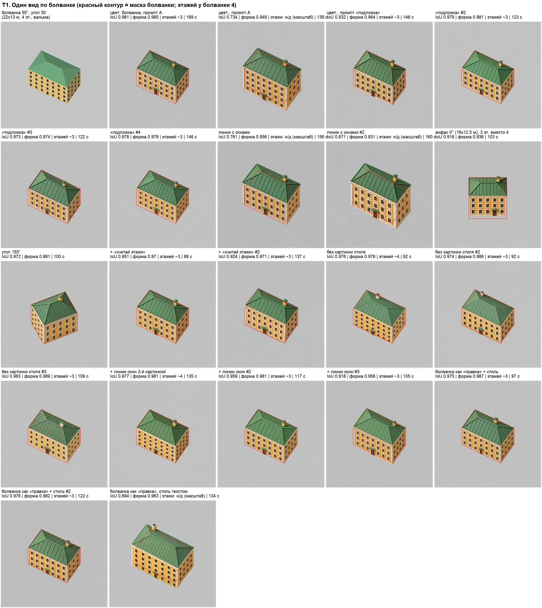
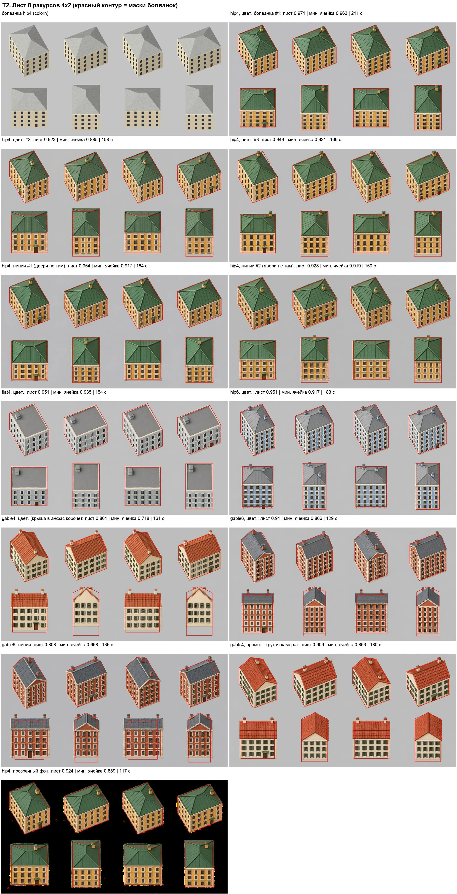
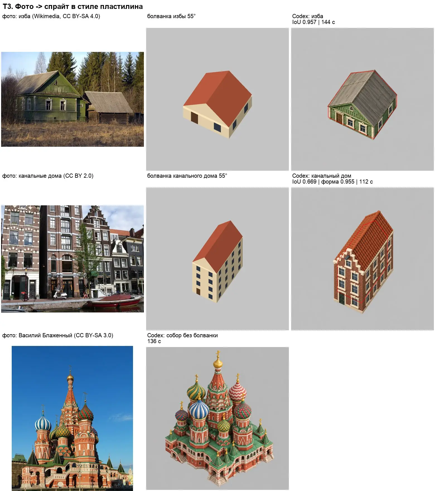
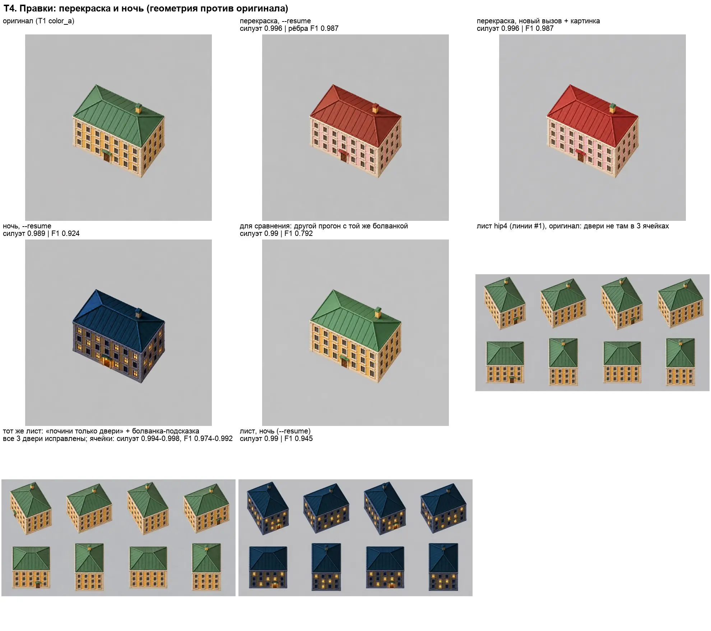
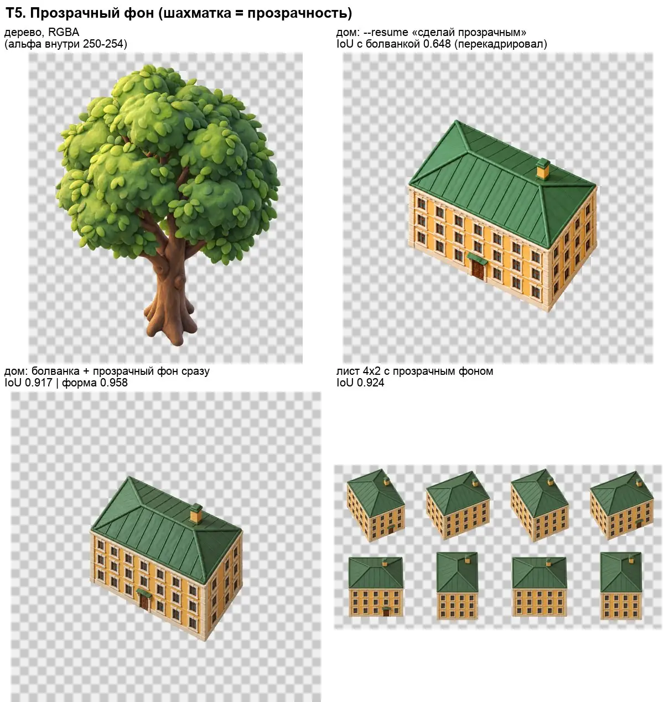
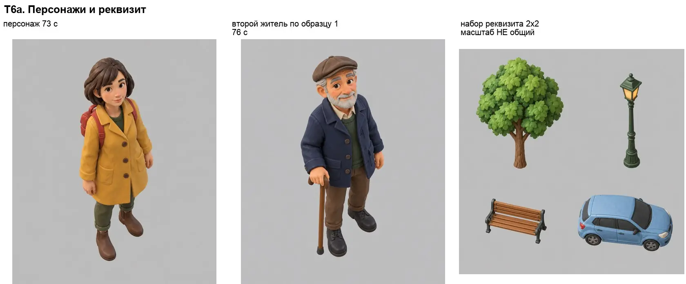
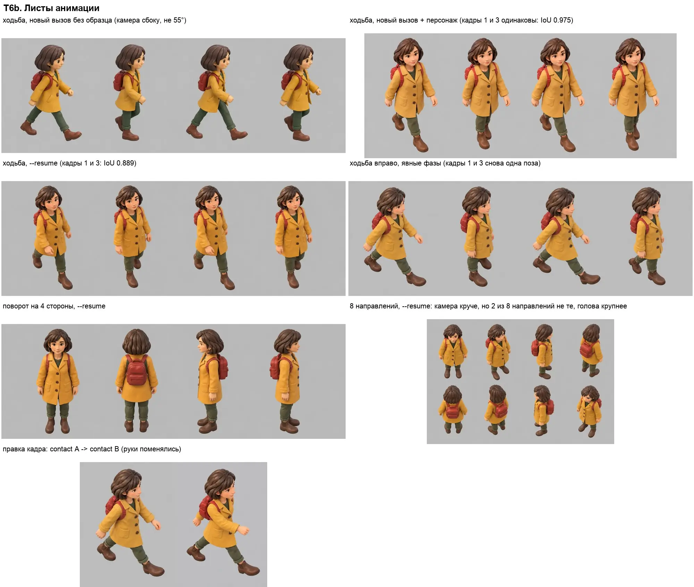
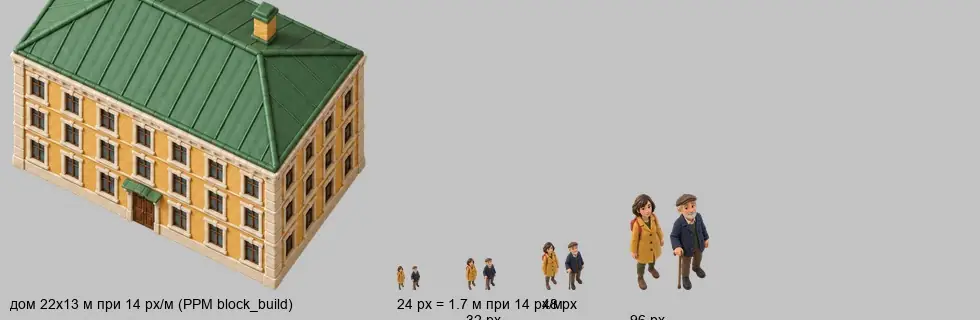
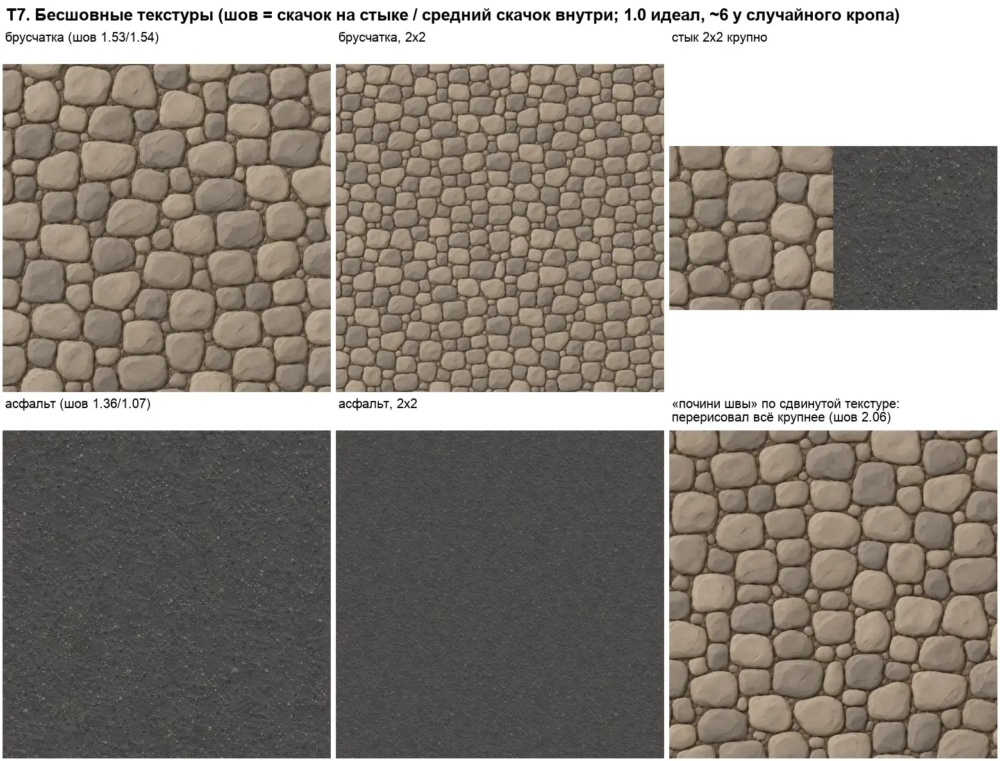

# Codex (GPT Image) для арта игры: что отдать, что оставить локально

17.10.2026, 18:20–19:10. Стиль «пластилин» по `docs/art-style-clay.webp`, камера ортографическая, наклон 55°.
За это время было 57 вызовов картинок и 1 вызов исследования (`codex exec`, режим read-only). Ни один вызов не упал, параллельно шло до 16 вызовов.
Сразу после исследования лимит подписки исчерпался («usage limit … try again at 10:07 PM»): картинки расходуют его в 3–5 раз быстрее текста.
Локальный конвейер не запускался: GPU занят. Базовые цифры взяты из `docs/building-sprites.md` и `reports/Спрайты зданий из ИИ.md`.
Контактные листы лежат в `reports/codex-research/`, лучшие промпты — в `tools/ai/lab/codex_prompts/`. Сырые прогоны (`R/` ниже) остались во временной папке сессии и в репозиторий не вошли.

## Коротко

- **Камеру и силуэт по болванке Codex держит.** Вид по цветной болванке: медиана IoU **0.974** по 17 прогонам, 12 из 17 прогонов ≥ 0.95. Наклон камеры по замеру 53–57°, угол поворота 30–33°. Без болванки он рисует под 35–40°.
- **Листы 4×2 из 8 ракурсов Codex рисует так же точно, как локальный Z-Image, и быстрее на тип дома.** По цветной болванке у вальмовых и плоских крыш IoU **0.92–0.97** за 2–3.5 мин.
  - Сетка листа сохраняется: сдвиг центров 0–4% ячейки (в лучшем листе ≤ 0.3%), масштаб 1.00–1.06.
  - Двери на правильных фасадах в 8 из 9 листов.
  - С двускатными крышами хуже: 0.86–0.91, в анфас скат крыши выходит короче.
- **Главный системный брак — этажей на один меньше.** Силуэт верный, но вместо 4 этажей Codex рисует 3 высоких: в 13 из 15 одиночных видов и в 9 из 10 проверенных листов. Промпт «считай этажи» делает только хуже. Тот же брак есть у Z-Image без линий окон. Нужна автопроверка и либо перегенерация, либо локальная доводка.
- **Правки — сильнейшая сторона Codex.** Перекраска и ночь сохраняют геометрию почти до пикселя: силуэт 0.99–1.00, совпадение рёбер в пределах 3 px 0.92–0.99. Два независимых прогона по одной болванке совпадают по рёбрам лишь на 0.79. Точечная правка листа («переставь двери») исправила все 3 ошибки за один вызов, остальные ячейки не изменились (F1 рёбер 0.97–0.99).
- **Персонажи:** дизайн, стиль и узнаваемость отличные, второй житель по образцу первого выходит в том же стиле и масштабе. **Цикл ходьбы Codex не делает**: кадры 1 и 3 получаются одной позой (IoU силуэтов 0.86–0.98), ноги и руки не чередуются. Среди 8 направлений 2 оказываются не теми.
- **Прозрачный фон есть.** Встроенный инструмент отдаёт настоящий RGBA. Альфа внутри объекта 250–254, а не 255, её надо прижать. Бесшовные текстуры получаются почти бесшовными: шов 1.5 при идеале 1.0, у случайного кропа ~6. Остаточный шов надо убирать локально: правкой через Codex он не чинится.

## Сводная таблица

| Задача | Codex (цифры) | Локальный конвейер (из отчётов) | Вердикт |
|---|---|---|---|
| Один вид по болванке | IoU медиана 0.974 (0.69–0.98, n=17). После совмещения масштаба форма ≥ 0.95 у всех. 2 из 17 ушли в масштаб ×1.2. Этажей 3 вместо 4 в 13 из 15. Анфас 0.918, угол 155° 0.972. 89–169 с | Z-Image: 0.98, ~100 с, но 3 этажа вместо 5. Qwen+ControlNet: 0.95–0.98, этажи верные, ~290 с | **Комбинировать.** Codex даёт стиль и форму, этажи проверять. Линии-болванку как единственную подсказку не использовать: 0.67–0.76 |
| Лист 4×2 (8 ракурсов) | hip4: 0.97 / 0.92 / 0.95. flat4 0.95, hip6 0.95. gable4 0.86 → 0.91 с промптом про крутую камеру, gable6 0.91. Двери по цветной болванке верны в 8 из 9 листов, по линиям ошибочны в 2 из 2. Этажи −1 в 9 из 10. 117–211 с | Z-Image: 7 ракурсов, 0.94, ~4 мин, этажи держатся линиями окон. Qwen: 0.81, 5.5 мин | **Отдать Codex листы вальмовых и плоских крыш** с автопроверкой (IoU ячеек, этажи, двери). Двускатные — после доводки промпта или локально |
| Фото → спрайт под болванку | изба 0.957 (144 с), узнаваема. Канальный дом: форма 0.955, но масштаб ×1.22 (сырой IoU 0.669) | Qwen → Z-Image: 0.84–0.98, ~4.5 мин | **Codex** плюс автоматическое совмещение масштаба по маске |
| Знаковое здание по фото | Василий Блаженный без болванки: крутой вид сверху, очень детально, 136 с | Qwen ~2 мин, ракурс выбирает сам, словами 55° не получить | **Codex** |
| Перекраска и ночь | силуэт 0.989–0.996, F1 рёбер 0.92–0.99, 78–132 с. Ночь целого листа: 0.990 / 0.945 | перекраска кодом в `block_build.py` (детерминированно) | **Codex** для ночи, сезонов и смены материала. Простая перекраска остаётся в коде |
| Точечная починка листа | двери в 3 ячейках исправлены, остальные ячейки 0.994–0.998 / F1 0.97–0.99, 112 с | `fix_cells.py`: нетронутые ячейки пиксель в пиксель | **Codex** для смысловых правок, `fix_cells` для формы |
| Прозрачный фон | RGBA из коробки. Болванка + прозрачность одним вызовом: 0.917, лист 0.924. Просьба «сделай прозрачным» в продолжении треда перерисовывает кадр (0.648) | Qwen отдаёт RGBA сразу | Серый фон + вырезание по маске (надёжнее) или прозрачность сразу в первом вызове |
| Реквизит | стиль единый, масштаб нет: 83–190 px/м внутри одного листа 2×2 | — | **Codex**, по вызову на предмет, масштаб нормализовать кодом по известным размерам |
| Персонаж (дизайн, повороты) | отлично, 73–83 с. 4 стороны консистентны, 8 направлений: 2 из 8 не те | PixelLab / Retro Diffusion для пиксельных жителей | **Codex** для эталонов и поворотов |
| Цикл ходьбы | личность держится (ширина головы ±1%), но нет чередования ног и рук | PixelLab / RD (по оценке пользователя лучше локального) | **Не Codex.** Анимацию делать отдельным инструментом или покадровыми правками с проверкой |
| Бесшовная текстура | брусчатка: шов 1.53 (случайный кроп 4.6–8), асфальт 1.36/1.07. Починка правкой провалилась: 2.06 | — | **Codex + локальная сшивка шва** |
| Скорость и надёжность | медиана 123 с на вызов, 0 сбоев на 57 вызовах, до 16 параллельно, по 1 картинке на вызов. **Лимит подписки кончается примерно за 90 картинок** | 1 GPU, последовательно | Пропускная способность у Codex выше, но окно подписки конечно |

## Оценка идеи

Отдавать Codex всё подряд не стоит: геометрия у него «почти точная», а этажность систематически сбита. Оставить его только для эталонов стиля значит недоиспользовать. Сильные стороны Codex: стиль «пластилин», который локально воспроизводится только упрощённо, правки с сохранением геометрии, листы по цветной болванке и параллельная работа. Слабые: счёт этажей, двускатные крыши в анфас, анимация, недетерминированность и лимиты подписки. Поэтому рекомендую **комбинированный конвейер с обязательной автопроверкой** (последний раздел).

## Как мерили

- **IoU силуэта** против маски болванки: `tools/metrics.py` (обёртка над `tools/ai/lab/qscore.py`).
  - **Размер кадра.** Codex отдаёт 1254×1254 для квадрата и 1774×887 для листа 2:1. Пропорции совпадают с болванкой, поэтому маска просто масштабируется до размера результата.
  - **Поправка к `qscore.fg_mask`.** Её порог (разница с цветом фона больше 40) пропускает бледные стены и серые плоские крыши на светло-сером фоне: лист flat4 получал 0.72 вместо 0.95. Порог 24 плюс closing и заливка дыр; на остальных картинках результат меняется не больше чем на ±0.005.
  - **«Форма»** — IoU после подгонки масштаба и центра (поиск ±6%, ±4 px). Отделяет «не та форма» от «та форма, но крупнее или сдвинута».
- **Наклон камеры** мерил `tools/ai/measure_sheet.py` на вырезанном здании. На одиночных видах замер надёжный: 53–57° при эталоне 54–55° на болванке. На ячейках листа он врёт: закруглённый цоколь сбивает выбор угла основания, и при IoU 0.98 выходит 28–43°.
- **Этажность.** `tools/floors.py` считает по полосе фасада период рядов окон через автокорреляцию: у болванки 39 px, то есть 4 этажа. `tools/bays.py` сверяет ряды и столбцы окон в анфасных ячейках листов.
- **Правки.** `tools/editcmp.py` и `tools/cellcmp.py` дают IoU силуэтов и F1 рёбер деталей с допуском 3 px. Для калибровки: два независимых прогона по одной болванке дают силуэт 0.99 и рёбра 0.79.
- **Цикл ходьбы.** `tools/walk.py` считает по кадрам рост, площадь, ширину головы, линию земли и попарный IoU силуэтов.
- **Текстуры.** `tools/tile.py` даёт «шов»: средний скачок на стыке, делённый на средний скачок между соседними столбцами внутри картинки. 1.0 означает идеально бесшовную текстуру.
- **Время** — время вызова `codex exec` целиком.
- Все числа лежат в `R/results.json`, пересчитать: `~/ComfyUI/.venv/bin/python R/tools/collect.py`.

## T1. Один вид по болванке

Болванка: `p30_iso_t_msk`, 22×13 м, 4 этажа, вальмовая крыша, угол 30°, наклон 55°. Стиль задан картинкой `style_clay.png`.

- **Цветная болванка работает, линии — нет.** Цветная: IoU 0.98, 0.98, 0.97, 0.98, 0.93 у удачных прогонов; провалы (0.73, 0.69) — тот же силуэт, увеличенный в 1.17–1.2 раза. Белые линии на чёрном: 0.76 и 0.67, форма 0.93–0.96, но здание всегда увеличено на 15–22%.
- **Промпт «подложка» убирает перекадрирование.** Фраза «treat Image 1 as an underlay … covers exactly the same pixels» дала 4 из 4 прогонов ≥ 0.93, в среднем 0.966.
- **Этажность — системный брак.** Период рядов окон 45–58 px вместо 39, то есть 3 высоких этажа вместо 4. Правильные 4 этажа получились в 2 прогонах из 15: «без картинки стиля» (1 из 3) и «линии окон второй картинкой» (1 из 3). «COUNT THE STOREYS…» сделало хуже: 2.6–2.8 этажа. Гипотеза: модель берёт крупные окна и высоту этажа с эталона стиля и из слов «19th-century».
- **Ракурсы.** Анфас 0° — самый трудный: 0.918, 3 этажа, низ фасада обрезан. Угол 155° без двери: 0.972.

Лучший промпт: `tools/ai/lab/codex_prompts/t1_color_c.txt` (картинки: 1 = `p30_iso_t_msk_color.png`, 2 = `style_clay.png`). Вариант «линии окон второй картинкой»: `tools/ai/lab/codex_prompts/t1_dual_a.txt`.

## T2. Лист 4×2 из 8 ракурсов: может ли Codex рисовать типы для города

| Лист | IoU листа | худшая ячейка | двери | этажи в анфасе | время |
|---|---|---|---|---|---|
| hip4, цветная болванка, #1 | **0.971** | 0.963 | верно | **4 из 4** | 211 с |
| hip4, цветная, #2 | 0.923 | 0.885 | верно | 3 | 158 с |
| hip4, цветная, #3 | 0.949 | 0.931 | верно | 3 | 166 с |
| hip4, линии с окнами, #1 / #2 | 0.954 / 0.928 | 0.917 / 0.919 | **ошибки** | 3 / 3 | 164 / 150 с |
| flat4, цветная | 0.951 | 0.935 | верно | 3 | 154 с |
| hip6, цветная | 0.951 | 0.917 | верно | 5 из 6 | 183 с |
| gable4, цветная | 0.861 | 0.718 (анфас) | верно | 3 | 161 с |
| gable4, + «крутая камера» | 0.909 | 0.863 | верно | 3 | 180 с |
| gable6, цветная / линии | 0.910 / 0.808 | 0.866 / 0.668 | — / ошибки | 5 из 6 | 129 / 135 с |
| hip4 с прозрачным фоном | 0.924 | 0.889 | на 65° не тот фасад | 3–4 | 117 с |

- **Сетка листа сохраняется точно.** Центр здания отходит от центра ячейки на 0–4%, масштаб 1.00–1.06, ни одно здание не залезает в соседнюю ячейку. Столбцы окон в анфасе стоят в пределах 2.5–5 px от болванки, поэтому растяжка повтором среднего пролёта применима.
- **Во всех 8 видах один и тот же дом.** Брак согласованности: труба привязана к экрану, а не к зданию; этажи −1 почти везде.
- **Двускатные крыши.** В анфасе скат к зрителю выходит низкой полосой, а стены выше. Абзац «STEEP CAMERA» поднял худшую ячейку с 0.72 до 0.86 (`tools/ai/lab/codex_prompts/t2_gable4_v2.txt`).
- **Ответ: да, Codex может рисовать листы типов** для вальмовых и плоских крыш, если есть автопроверка и починка.

Лучший промпт: `tools/ai/lab/codex_prompts/t2_colorn_a.txt` (картинки: 1 = `blk_hip4_colorn.png`, 2 = `style_clay.png`).

## T3. Реальное фото → спрайт

- **Изба** (болванка 8×7 м при 55° + фото + эталон стиля): IoU **0.957**, 144 с, узнаётся.
- **Канальный дом**: форма 0.955, но дом увеличен в 1.22 раза (сырой IoU 0.669); лечится совмещением по маске в коде.
- **Василий Блаженный** без болванки: крутой вид сверху, все главы на месте, 136 с.
- Атрибуция фото: изба — Dmitry Makeev, CC BY-SA 4.0; канальные дома — Lyn Gateley, CC BY 2.0; собор — Alvesgaspar, CC BY-SA 3.0.

## T4. Правки: перекраска, ночь, точечная починка

| Правка | Силуэт к оригиналу | F1 рёбер (3 px) | Время |
|---|---|---|---|
| Розовые стены и красная крыша, `--resume` | 0.996 | 0.987 | 78 с |
| То же, новый вызов, оригинал приложен как «EDIT TARGET» | 0.996 | 0.987 | 132 с |
| Ночь, `--resume` | 0.989 | 0.924 | 110 с |
| Ночь целого листа 4×2, `--resume` | 0.990 | 0.945 | 124 с |
| Лист: «почини только двери» + болванка как подсказка | ячейки 0.994–0.998 | 0.974–0.992 | 112 с |
| Для калибровки: другой прогон по той же болванке | 0.990 | 0.792 | — |

Правка в продолжении треда и в новом вызове с приложенной картинкой работают одинаково, треды хранить не нужно. Брак: «сделай прозрачный фон» в продолжении треда перекадрировал здание (0.655); «почини швы» на текстуре перерисовал её целиком.

## T5. Прозрачный фон

Настоящий RGBA, альфа внутри 250–254 (прижать до 255), кромка 1–4% пикселей без ореола. Болванка и прозрачность в одном вызове: 0.917 / 0.924 против 0.97 с серым фоном. Рекомендация: серый фон `#c3c3c3` и вырезание по маске болванки.

## T6. Мелкие ассеты и персонажи

- **Персонаж** — лучшее, что получалось в этом проекте в «пластилине». Второй житель с первым как эталоном вышел в том же стиле и масштабе. Повороты на 4 стороны держат личность; 8 направлений — 2 из 8 не те.
- **Цикл ходьбы** не получается ни в одном из 4 вариантов: кадр 3 ≈ кадр 1, ноги не чередуются. Анимацию Codex не отдавать.
- **Реквизит 2×2:** стиль единый, масштаб гуляет 83–190 px/м. Делать по предмету на вызов.
- **Игровой масштаб.** При 14 px/м житель ростом 1.7 м занимает ~24 px, пластилиновая детализация пропадает. Стоит решить, при каком зуме персонажи показываются крупно.

## T7. Бесшовные текстуры земли

Брусчатка: шов 1.53 (случайный кроп 4.6–8), асфальт 1.36 / 1.07. Правка «почини швы» провалилась (2.06). Брать текстуру у Codex, шов убирать локально (кроссфейд или сдвиг на полкадра с инпейнтом), цель ≤ 1.1.

## T8. Возможности и ограничения GPT Image (на 17.10.2026)

Источник: исследование Codex с `--search` (`R/runs/t8_research/answer.md`); ✔ — перепроверено по документации.

- **Модели.** В API `gpt-image-2.5-sunburst` (точные правки) и `gpt-image-2.5-flare` (быстрая), snapshot 2026-09-08 ✔ ([guide](https://developers.openai.com/api/docs/guides/image-generation)); `gpt-image-2` snapshot 2026-04-21 ✔. Какая модель стоит за `image_gen` в Codex — неизвестно.
- **Размеры** ✔: стороны кратны 16, максимум 3840 px, соотношение от 1:3 до 3:1, 0.66–8.3 Мп. `image_gen` в Codex отдавал ~1.57 Мп.
- **Прозрачность** ✔ у 2.5 (`background: "transparent"`); у `gpt-image-2` в API, по skill Codex, нет.
- **Маска** ✔ — только подсказка. Референсов до 16 (по skill Codex). Seed нет, детерминированности нет.
- **Цены** ✔ 2.5 Sunburst: вход $5 / 1M текстовых, $8 / 1M токенов-картинок; выход $30 / 1M (Batch $15). Лимиты: 20 / 150 / 250 картинок в минуту по тирам.
- **Подписка и автоматизация.** Лимиты Plus/Pro на картинки не опубликованы. В Terms of Use есть запрет программного извлечения Output и использования Output для конкурирующих моделей: массовая генерация через подписку — серая зона, для тысяч картинок надёжнее API.

## Рекомендации

**Отдать Codex:** эталоны стиля; листы типов 4×2 для вальмовых и плоских крыш по цветной болванке с автопроверкой; варианты (ночь, сезоны, материалы) правкой; знаковые здания и дома по фото; дизайн и повороты персонажей (не анимацию); реквизит по предмету на вызов; текстуры с локальной сшивкой шва.

**Оставить локально:** детерминированные шаги (перекраска, нарезка, растяжка пролётами, `fix_cells.py`) и все проверки; доводку этажности; анимацию жителей (PixelLab / Retro Diffusion); массовую генерацию и LoRA (сначала прочитать ToS).

**Комбинированный конвейер для домов:** `block_types` → цветной лист болванок → Codex рисует лист (промпт T2, эталон стиля второй картинкой) → автопроверка (IoU ячеек ≥ 0.93, сдвиг ≤ 2%, масштаб 0.97–1.06, ряды окон, дверь) → починка (правка Codex / `fix_cells` / перегенерация) → варианты правкой → нарезка и раскладка `block_build.py`.

**Риски:** этажность −1; недетерминированность и смена модели за `image_gen` без предупреждения (хранить ассеты, а не рецепты); лимиты и условия подписки; двускатные крыши в анфас и перекадрирование; IoU не видит пропавший этаж — проверки этажей и дверей обязательны.

## Файлы

- Контактные листы: `reports/codex-research/cs_*.webp`.
- Все вызовы: `R/runs/<имя>/` (`prompt.md`, `events.jsonl`, `answer.md`, `images/`); промпты `R/prompts/`; числа `R/results.json`, `R/analysis/`; скрипты замеров `R/tools/`.
- Thread ID: вид `01a14a75-72d1-7323-8f32-5dba32de89b9`, лист `01a14a75-72f8-7641-abc0-af2b9cae9d59`, персонаж `01a14a76-3dd9-7471-a685-614b11f24225`.
