# Спрайты зданий из ИИ: что получилось за ночь

Красивые спрайты зданий теперь получаются локально и воспроизводимо. Это верно и для домов по описанию, и для реальных зданий по фото. Решают дело не модели, а **болванки**: процедурный генератор знает форму, угол и размер дома и подсказывает их модели картинкой.

- **По описанию.** Z-Image-Turbo рисует **лист из 7 ракурсов за один проход, примерно за 4 минуты**. Во всех ячейках получается один и тот же дом, углы точно по болванкам, этажность правильная. Ракурсы 270–345° достраиваются зеркалом. Ломаные ячейки перерисовываются по отдельности.
- **По реальному фото.** Нужны два прохода. Первый — **Qwen-Image-2.1**: на вход идут болванка *первой* картинкой (форма и угол) и фото *второй* (узнаваемость). Второй — **Z-Image** от результата Qwen с линиями окон: он добавляет детали и «сказочную» красоту. Форма совпадает с болванкой на 0.84–0.98 (IoU).
- **Знаковые здания** (Кремль, Василий Блаженный, Статуя Свободы) в мире существуют в одном экземпляре. Им хватает одного красивого вида: генератор разворачивает под него участок. Лист ракурсов им не нужен.
- **ChatGPT** строго следит за углами, если об этом прямо попросить: ошибка до ±4°. Но наклон камеры у него гуляет от листа к листу (22–41°), поэтому каждый лист нужно замерять.
- **Камера движка (исправлено):** нужна настоящая ортографическая камера с наклоном ~55°, а не 30°. При 30° за зданиями прячется в 2–2.5 раза больше улиц. Подробности в разделе «Камера движка».
- **Технические грабли этой ночи.** Mac засыпал через минуту простоя, и генерация замирала посреди шага. Кроме того, 64 ГБ памяти не хватает, когда Qwen и Z-Image одновременно лежат в кэше. Оба места исправлены в `~/ComfyUI/start.sh`.

## Рецепт 1. Дом по описанию → лист ракурсов (Z-Image-Turbo)

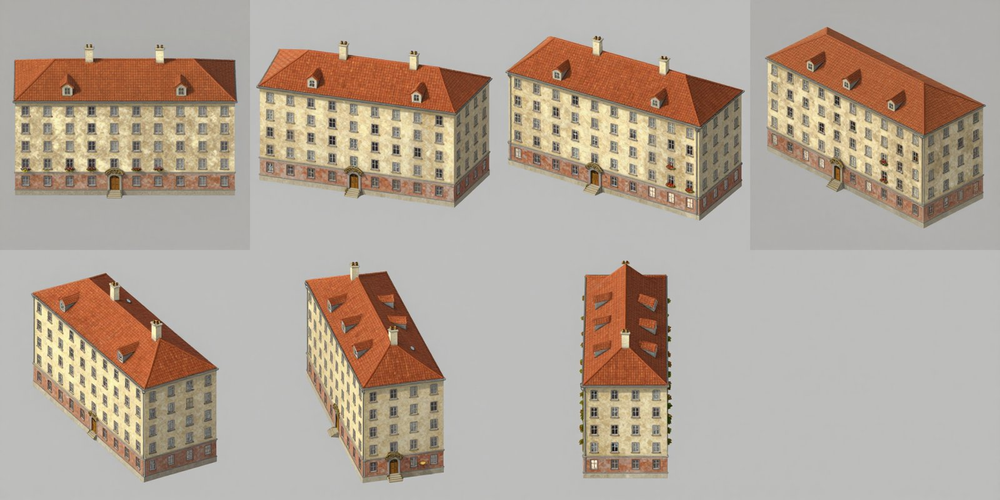

| Параметр | Значение |
|---|---|
| Болванка | Лист 4×2, ячейки 512 px = 2048×1024. Углы 0–90° с шагом 15°, остальные зеркалом. Окна «высокие», как в домах XIX века (1×1.8 м) |
| Старт | img2img от цветной болванки с шумом, `denoise 0.85`. У Turbo с 8 шагами это ровно «пропустить 1 из 9», значения ≥0.89 молча игнорируют исходник |
| ControlNet | Fun ControlNet Union 2.1, **линии с окнами, сила 0.35**, отпускается на последних 20% шагов |
| Промпт | «Сказочная» иллюстрация + явно «five rows of windows» |
| Время | **~3.5–4 мин на тип дома во всех ракурсах** (M3 Max) |

Что не работает:
- **без линий окон** модель рисует 1–2 этажа вместо пяти;
- **линии окон с силой ≥0.45 или ячейки 384 px** дают плоские «панельные» фасады;
- **холсты больше ~2 Мп** (2560×1536) падают на Mac: Metal не тянет внимание внутри VAE.

**Починка брака** (`tools/ai/lab/fix_cells.py`): в сломанную ячейку подставляется её болванка, и ячейка перерисовывается по маске, а весь остальной лист служит контекстом. Нетронутые ячейки остаются пиксель в пиксель.

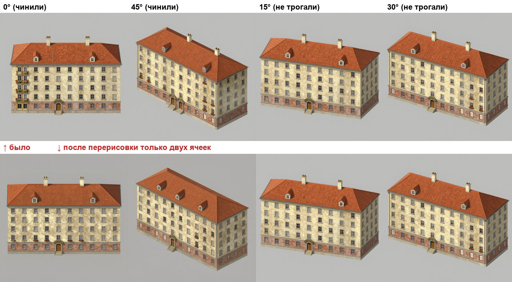

**Нарезка** (`tools/ai/cut_sheet.py`): лист превращается в набор RGBA-спрайтов с одним масштабом и точкой привязки к земле. Зеркальные углы и `sprites.json` скрипт делает сам.

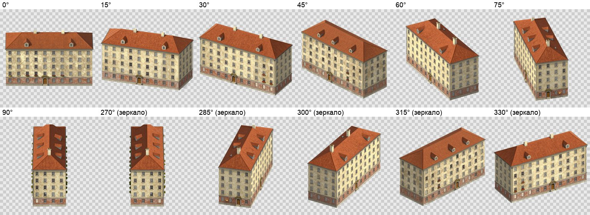

## Рецепт 2. Реальное здание по фото → спрайт (Qwen → Z-Image)

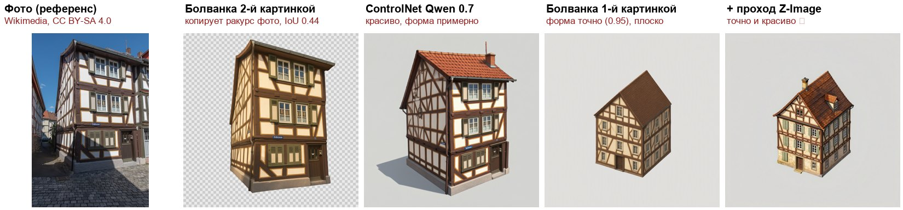

Проверены четыре способа. Удачен только последний:
1. **Болванка второй картинкой, фото первой.** В режиме правки Qwen бережёт композицию **первой** картинки. Если на фото сильная перспектива (фахверк снят снизу вплотную к углу), модель повторяет её и игнорирует болванку: IoU 0.44.
2. **ControlNet Qwen по линиям, сила 0.7–1.4.** Красиво, изометрия правильная, но форма и угол только «примерно».
3. **Болванка первой, фото второй.** Та же особенность Qwen теперь работает на нас: модель «редактирует» болванку в настоящий дом. Форма точная (IoU 0.84–0.98), узнаваемость есть, но картинка плоская и скучная.
4. **Тот же шаг плюс второй проход Z-Image** (`tools/ai/lab/zbeauty.py`): img2img от результата Qwen, `denoise 0.75`, линии окон 0.4, «сказочный» промпт с описанием дома. **Точно, узнаваемо и красиво.**

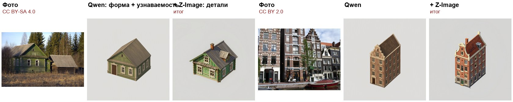
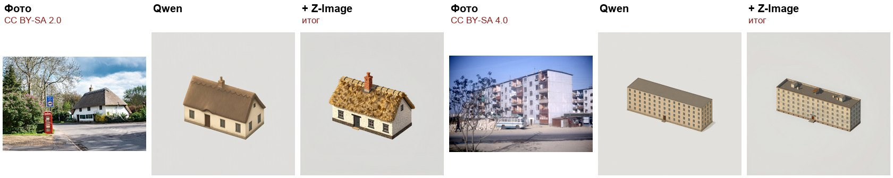

Время: Qwen ~3 мин на дом с одним образцом, Z-Image ~1.5 мин.

Описание дома для второго прохода я писал сам по фото. В конвейере его может давать мультимодальная модель (Claude или тот же Qwen3-VL).

**Картинка-эталон стиля не работает.** Идея была такая: третьей картинкой подать красивый спрайт, чтобы держать единый стиль всей библиотеки. На деле Qwen **копирует сам объект** с эталона и игнорирует болванку и фото. Стиль задаётся текстом, вторым проходом Z-Image или своей LoRA.

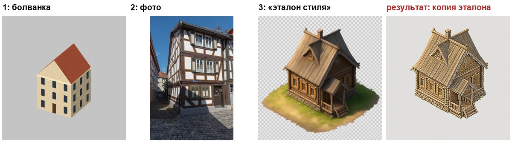

### Лист ракурсов по фото

Тот же приём работает и для целого листа. Qwen получает первой картинкой **лист из 13 болванок** (0–180° с шагом 15°, 1920×1152), второй — фото избы. Затем Z-Image делает второй проход по всему листу с линиями окон 0.35 (`tools/ai/lab/zbeauty_sheet.py`).

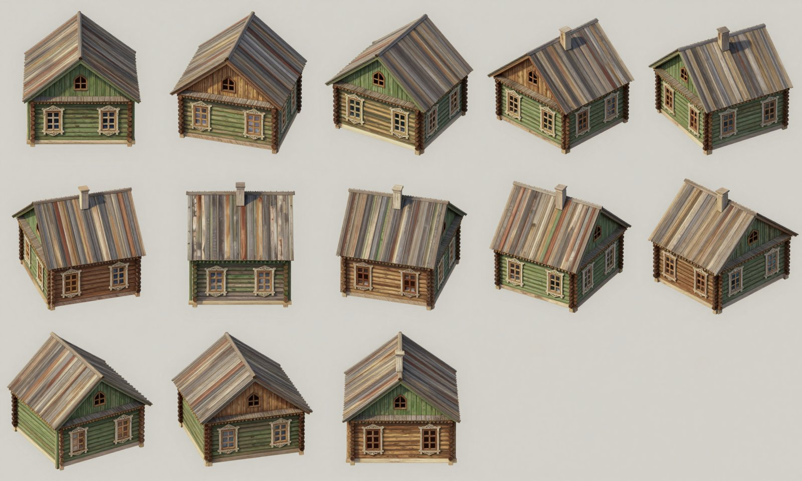

- **Что получилось.** Во всех 13 ракурсах тот же дом: зелёные брёвна, резные наличники, окно во фронтоне. Углы и форма соответствуют болванкам.
- **Цена.** ~8 мин Qwen + ~8 мин Z-Image на лист. В пересчёте на ракурс выходит быстрее одиночных генераций.
- **Слабое место.** Покраска стен «плывёт» между ракурсами: где-то брёвна зелёные, где-то некрашеные. Лечится явным «all log walls painted green» в промпте второго прохода или перерисовкой отдельных ячеек.

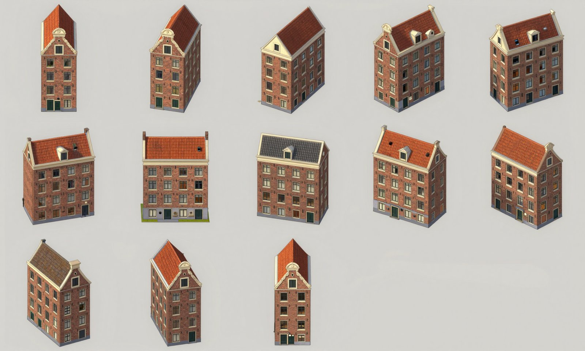

Канальный дом получился лучше: кирпич, белые наличники и колоколообразный фронтон держатся во всех ракурсах. Но у двух ячеек (120° и 150°) крыша другого цвета. Это типичный «брак отдельной ячейки», и его перерисовывает `fix_cells.py`.

## Рецепт 3. Знаковые здания

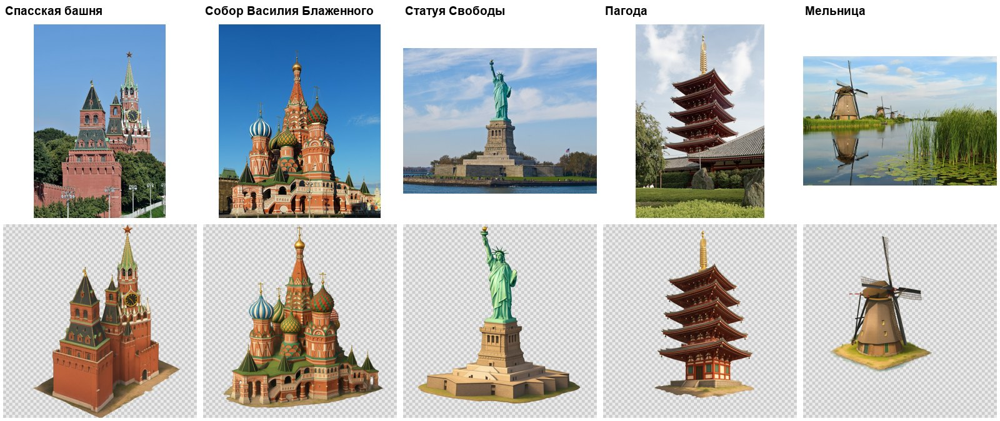

Это Qwen-Image-2.1 в режиме правки: одно фото, промпт «перерисуй в изометрии как спрайт, вырежи только здание», прозрачный фон прямо из модели. **~2 минуты на здание**, болванка не нужна. Ракурс модель выбирает сама, обычно хороший диагональный. Знаковое здание стоит в мире одно, поэтому генератор разворачивает под этот ракурс участок, а второй вид получается зеркалом. Для сложных форм вроде куполов и статуй болванку пришлось бы строить вручную, и вышло бы хуже.

Тот же рецепт на остальных референсах: от разрушенной избы до сталинской высотки.

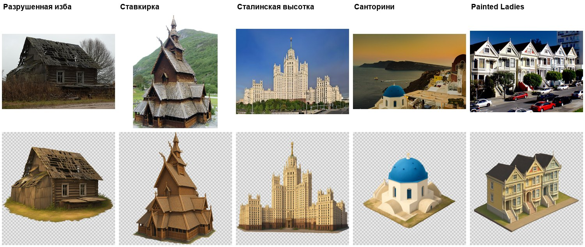

Разрушенная изба сохранила провалившуюся крышу и выбитые доски, а это самый трудный случай для «уютного» стиля. Высотку модель упростила, но силуэт узнаётся. Здание с фото Санторини модель додумала: на снимке купол виден только частично.

## Только Qwen-Image-2.1: что умеет сам

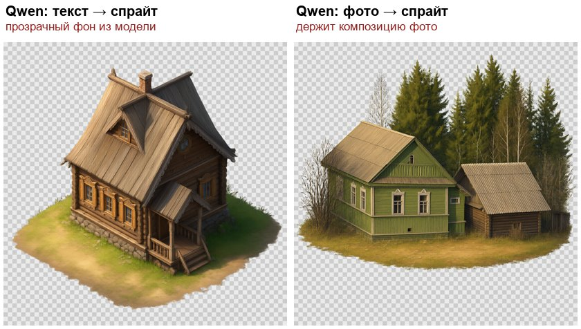

- **Текст → спрайт с настоящим прозрачным фоном.** Модель отдаёт RGBA прямо из VAE, если в промпте написано «RGBA image with transparency». Вырезать фон не нужно.
- **Фото → спрайт.** Без болванки модель переносит композицию снимка: ракурс, соседние деревья, сарай.
- **Скорость.** Turbo-LoRA поверх базовой модели работает за 8 шагов, ~8 с на шаг при 1024². С тремя картинками-образцами ~40 с на шаг.

### Дома разных стран по описанию (Qwen, без фото)

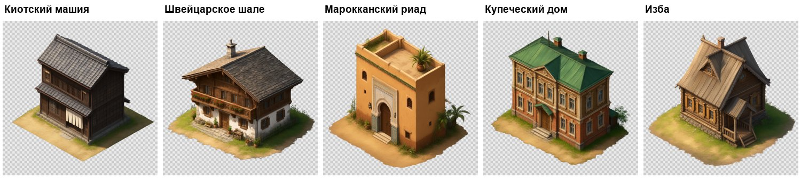

Одна строка описания и общий стилевой хвост промпта дают **~75–90 с на спрайт с прозрачным фоном**. Стиль между разными странами держится ровно. Ракурс модель выбирает сама, поэтому так удобно делать «канонический вид» нового типа дома. Затем этот вид становится референсом (Рецепт 2), и по нему строится лист ракурсов.

## Камера движка (исправлено 17.10, после ночи)

Ночной вывод «перейти на изометрию 2:1 с наклоном 30°» был ошибкой для игры про наблюдение за персонажами. Здание высотой h закрывает за собой h·ctg(наклона) метров улицы. Посчитал на настоящих городах из генератора (`tools/ai/lab/occlusion.js`, `occlusion_streets.py`), какая доля улиц скрыта целиком для человека ростом 1.7 м:

| Город | 30° | 45° | 55° | 60° | Движок сейчас |
|---|---|---|---|---|---|
| Москва | 24% | 16% | 11% | 9% | 10% |
| Стамбул | 28% | 17% | 12% | 10% | 10% |
| Париж | 42% | 32% | 25% | 22% | 22% |
| Нью-Йорк | 50% | 45% | 39% | 36% | 37% |

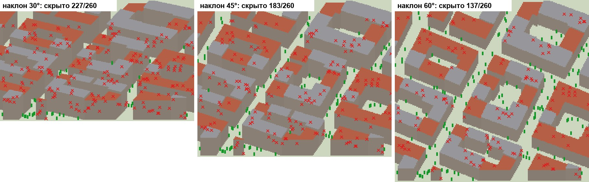

Текущая проекция движка (земля не сжата, высоты ×0.6) по видимости равна настоящей камере с наклоном ~59°. «Вид 3/4» и ортографическая камера — одно и то же: камера смотрит на город с юга под наклоном. Наклон рёбер 2:1 появляется только у домов, повёрнутых на 45°.

Модели рисуют хорошо на любом наклоне от 30° до 60°: совпадение формы на анфасе 0.91–0.98 при каждом наклоне, ухудшения нет (Z-Image, по 3 сида). Две оговорки:
- **Этажи.** На крутом наклоне фасад на экране короче, и без линий окон модель рисует меньше этажей. Лечится линиями окон, как в рецепте листа.
- **Qwen без ControlNet крутой наклон не держит.** С болванкой на 55° он съезжает к своим привычным ~30–35°.

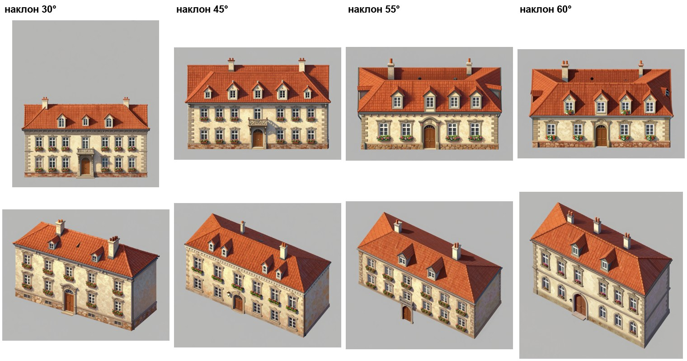

**Рекомендация:** настоящая ортографическая камера с наклоном ~55°. Видимость улиц как сейчас, а модели получают «физичную» камеру. Даже при 55° в Париже скрыта четверть улиц, в Нью-Йорке ~40%, поэтому нужна механика поверх камеры: силуэты людей сквозь здания и полупрозрачность домов вокруг выбранного персонажа.

## Qwen в одиночку против связки (17.10)

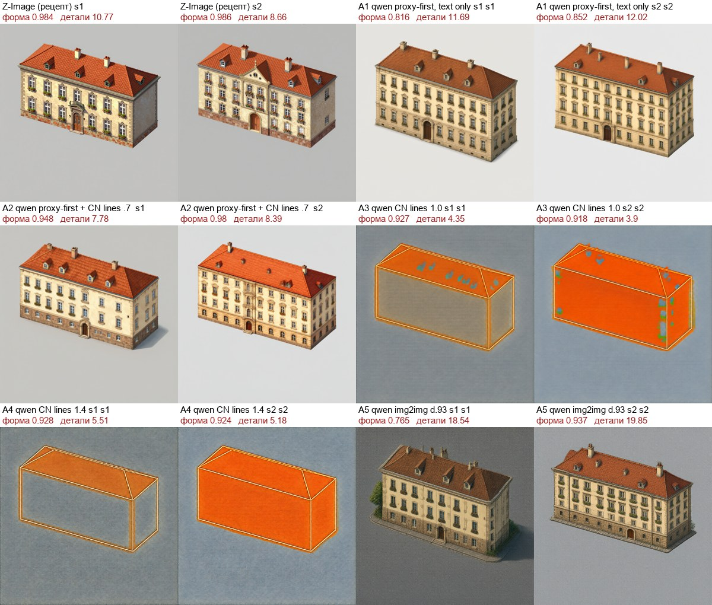
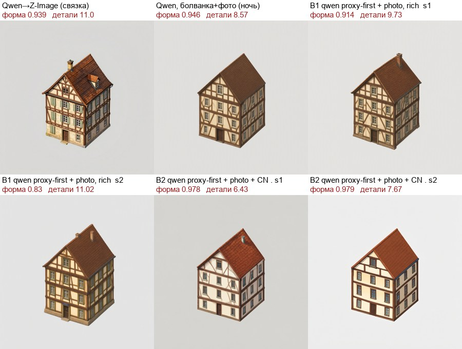
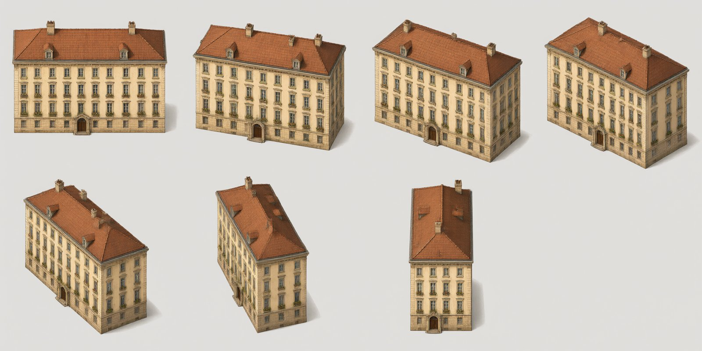

| Задача | Вариант | Форма | Время | На глаз |
|---|---|---|---|---|
| Дом по описанию, 1 вид | Z-Image (рецепт) | 0.98 | ~100 с | красиво, но 3 этажа вместо 5 |
| | **Qwen: болванка первой + ControlNet 0.7** | **0.95–0.98** | ~290 с | красиво, 5 этажей ✅ |
| | Qwen: болванка первой, без ControlNet | 0.82–0.85 | ~130 с | красиво, масштаб плывёт |
| | Qwen: только ControlNet 1.0–1.4 | — | ~135 с | ❌ рисует оранжевую коробку |
| | Qwen: img2img от болванки | 0.77 / 0.94 | ~75 с | красиво, 1 из 2 мимо |
| Фахверк по фото | **Qwen → Z-Image (связка)** | 0.94 | ~4.5 мин | самый детальный ✅ |
| | Qwen: болванка + фото | 0.83–0.91 | ~3 мин | проще |
| | Qwen: болванка + фото + ControlNet | 0.98 | ~8.5 мин | точно, но плоско |
| Лист из 7 ракурсов | Z-Image | 0.94 | ~4 мин | хорошо |
| | Qwen: болванка-лист первой | 0.81 | ~5.5 мин | красивее, 5 этажей, но масштаб плывёт и на 90° дверь не на той стене |

**Вывод.** Для домов по описанию Qwen справляется в одиночку и даже красивее, но в 2–3 раза медленнее. Точную форму он держит только вместе с ControlNet. Для реальных зданий по фото связка Qwen → Z-Image по-прежнему лучшая по красоте.

## ChatGPT как источник листов

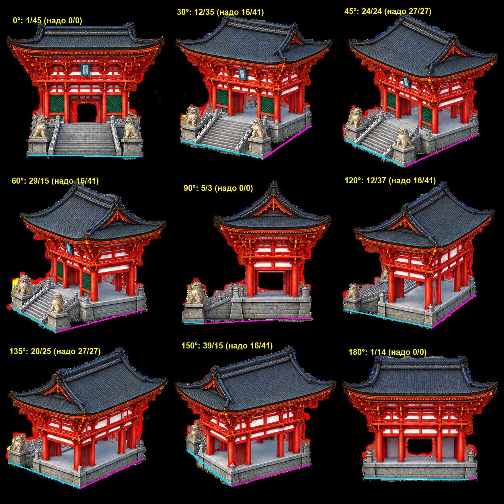

С промптом «строго следи за углами» нарисованные углы совпали с запрошенными в пределах ±4°. Без этого 30° и 60° тянулись к 45°, ошибка ~12°. Наклон камеры гуляет между листами: 22–41°. Порядок работы:
1. замерить лист через `tools/ai/measure_sheet.py` (угол ±5°, наклон ±3°);
2. перерисовать только промахнувшиеся ракурсы.

## Инфраструктура

- **ComfyUI** v0.41.2 лежит в `~/ComfyUI`, описание в `~/ComfyUI/LOCAL_SETUP.md`. Запуск `~/ComfyUI/start.sh`, остановка `~/ComfyUI/stop.sh`, адрес http://127.0.0.1:8188.
- **Модели** (bf16, ~68 ГБ): Z-Image-Turbo с ControlNet Union 2.1, Qwen-Image-2.1 с Turbo-LoRA, Qwen3-VL-8B и ControlNet. Все проверены по sha256.
- **Сон Mac.** В настройках питания сон через 1 минуту простоя, и генерация замирала посреди шага: один шаг занимал 17 минут. Теперь `start.sh` держит Mac бодрствующим, пока работает сервер (`caffeinate -w`).
- **Память.** Qwen с энкодером (~32 ГБ) и Z-Image (~20 ГБ) в кэше одновременно загоняли систему в своп на 28 ГБ, и задачи шли по 20–50 минут. Теперь сервер запускается с `--cache-none`: модели выгружаются после каждой задачи. Задачи стоит группировать по моделям.
- **Галерея ComfyUI** переживает перезапуски (`--enable-assets`).
- **Скрипты экспериментов** лежат в `tools/ai/lab/` (README там же). Инструменты в `tools/ai/`: `angle_sheet.py`, `measure_sheet.py`, `cut_sheet.py`.

## Что решить и что дальше

1. **Камера движка.** Переходим на ортографическую камеру с наклоном ~55° (видимость улиц как сейчас)? От этого зависит, в какой проекции генерировать библиотеку.
2. **Автоматический конвейер:** генератор выдаёт тип дома и размеры → болванки → лист → автопроверка (силуэт, углы) → перерисовка брака → нарезка. Все звенья уже есть по отдельности, их осталось соединить.
3. **Описание дома по фото** для второго прохода сделать автоматическим.
4. **Своя LoRA стиля** на 30–100 отобранных спрайтах, чтобы закрепить единый стиль всей библиотеки.

## Атрибуция фото-референсов

Фото взяты с Wikimedia Commons под свободными лицензиями. Список с авторами и ссылками лежит в `~/ComfyUI/input/refs/attribution.json`:

| Файл | Автор | Лицензия | Источник |
|---|---|---|---|
| hut_ruined | Dmitry Makeev | CC BY-SA 4.0 | [2005 year - Abandoned village in the Tver region. ](https://commons.wikimedia.org/wiki/File:2005_year_-_Abandoned_village_in_the_Tver_region._Village_houses_in_Russia.jpg) |
| izba | Dmitry Makeev | CC BY-SA 4.0 | [Russia. Abandoned village in the Tver region 07.jp](https://commons.wikimedia.org/wiki/File:Russia._Abandoned_village_in_the_Tver_region_07.jpg) |
| kremlin_tower | Dmitry Ivanov. | CC BY-SA 4.0 | [Moscow Kremlin Towers of east wall.jpg](https://commons.wikimedia.org/wiki/File:Moscow_Kremlin_Towers_of_east_wall.jpg) |
| st_basil | Alvesgaspar | CC BY-SA 3.0 | [Moscow July 2011-4a.jpg](https://commons.wikimedia.org/wiki/File:Moscow_July_2011-4a.jpg) |
| liberty | William Warby | CC BY 2.0 | [Statue of Liberty, NY.jpg](https://commons.wikimedia.org/wiki/File:Statue_of_Liberty,_NY.jpg) |
| pagoda | Jakub Hałun | CC BY 4.0 | [Five-storied Pagoda of Sensoji Temple in Tokyo, 20](https://commons.wikimedia.org/wiki/File:Five-storied_Pagoda_of_Sensoji_Temple_in_Tokyo,_20240821_1616_5263.jpg) |
| canal_house | Lyn Gateley from Silicon Valley, CA, USA | CC BY 2.0 | [DSC00288, Canal Cruise, Amsterdam, Netherlands (33](https://commons.wikimedia.org/wiki/File:DSC00288,_Canal_Cruise,_Amsterdam,_Netherlands_(338955340).jpg) |
| half_timbered | Tilman2007 | CC BY-SA 4.0 | [Alsfeld, Grabbrunnen 1-20160504-002.jpg](https://commons.wikimedia.org/wiki/File:Alsfeld,_Grabbrunnen_1-20160504-002.jpg) |
| khrushchevka | Thomas Taylor Hammond (1920-1993) | CC BY-SA 4.0 | [Hammond Slides Baku 11.jpg](https://commons.wikimedia.org/wiki/File:Hammond_Slides_Baku_11.jpg) |
| painted_lady | Bernard Spragg. NZ from Christchurch, New Zealand | CC0 | [Painted ladies (13) (8654122328).jpg](https://commons.wikimedia.org/wiki/File:Painted_ladies_(13)_(8654122328).jpg) |
| santorini | Andreas Pantziarides | CC BY 3.0 | [Santorini (214745825).jpeg](https://commons.wikimedia.org/wiki/File:Santorini_(214745825).jpeg) |
| stalinist | Юрий Д.К. | CC BY 4.0 | [Skyscraper on Kotelnicheskaya Embankment with the ](https://commons.wikimedia.org/wiki/File:Skyscraper_on_Kotelnicheskaya_Embankment_with_the_backdrop_of_smoke_from_Wildberries_fire.jpg) |
| stave_church | KenSwe72 | CC0 | [Borgund stave church (17162).jpg](https://commons.wikimedia.org/wiki/File:Borgund_stave_church_(17162).jpg) |
| thatched_cottage | Jim Osley | CC BY-SA 2.0 | [Shepreth , thatched cottage - geograph.org.uk - 80](https://commons.wikimedia.org/wiki/File:Shepreth_,_thatched_cottage_-_geograph.org.uk_-_8025226.jpg) |
| windmill | Tarod | CC BY-SA 3.0 nl | [The windmills of Kinderdijk.JPG](https://commons.wikimedia.org/wiki/File:The_windmills_of_Kinderdijk.JPG) |
